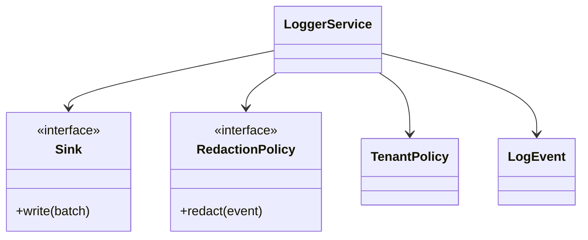

# Distributed Logger — Python LLD Exercise

Design a structured logging ingestion component with bounded batching, redaction, tenant policy and pluggable sinks.

## Model
LogEvent, TenantPolicy, IngestBatch, Parser, RedactionPolicy Protocol, Sink Protocol, RetentionPolicy and LoggerService.

## Diagram

## Implementation
Use dataclasses, Protocol ports, injected clock/sink, bounded queue/batch, explicit flush/close, redaction before persistence and domain-specific retry errors. Keep provider I/O outside domain logic.

## Tests
Batch thresholds; flush/close; sink timeout/retry; poison event; redaction; tenant quota; duplicate batch; backpressure; timestamp validation.

## Interview prompts
Where is durability guaranteed? How do you avoid unbounded memory? How isolate noisy tenants? How replay dead-letter events safely?
