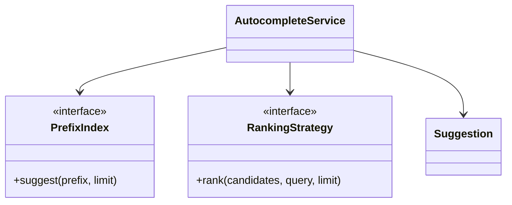

# Search Autocomplete — Python LLD Exercise

Implement a low-latency prefix suggestion component with normalization, ranking and a replaceable index.

## Model
- Suggestion(id, text, locale, popularity, status)
- PrefixIndex interface: add/remove/rebuild/suggest(prefix, limit)
- RankingStrategy Protocol: rank(candidates, query, limit)
- AutocompleteService: normalize → lookup → policy filter → rank → return

## Diagram

## Implementation
Use dataclasses for immutable suggestions, Protocol for index/ranker, Unicode normalization (NFKC + casefold), bounded prefix length and an in-memory trie or sorted-prefix adapter. Keep index building separate from query handling.

## Tests
Normalization across locale/Unicode; empty/long prefix; top-K ordering; inactive suggestion filtering; duplicate updates; index swap; ranking strategy fallback; concurrent rebuild/read contract.

## Interview prompts
Trie vs sorted list? How bound candidate count? How publish index atomically? How protect personalized ranking privacy and latency?
