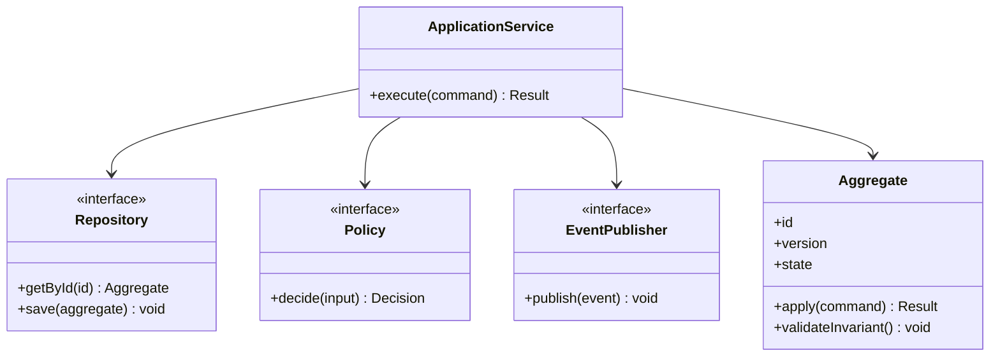
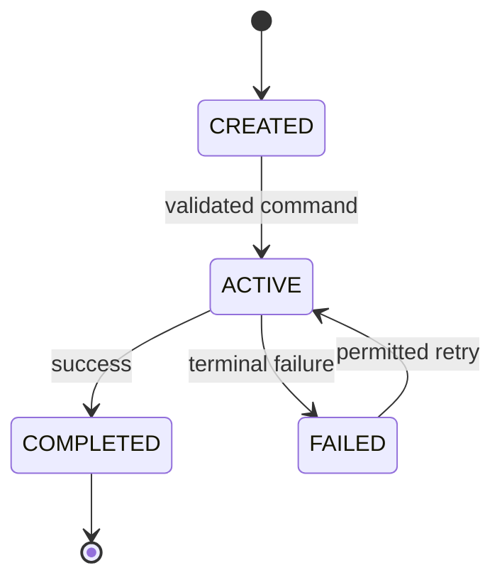

# Video Platform — TypeScript LLD Exercise

Upload sessions, Video, Rendition and PlaybackSession; resumable upload and publish only when required renditions are ready.

## Domain model

## State lifecycle

Adapt states to the domain and document forbidden transitions.

## Design
- Entities own identity and lifecycle; value objects validate immutable values.
- Application service coordinates use cases; domain methods enforce invariants.
- Repository and provider interfaces isolate IO; inject implementations.
- Use Strategy for real policy variation, State for lifecycle, Adapter for external providers, and domain events for side effects.
- Use optimistic version checks and idempotency keys for concurrent/retried commands.

## TypeScript implementation guidance
Use strict TypeScript, readonly value objects, discriminated unions for states, injected ports and explicit Result/error types.

## Suggested files
domain/aggregate.ts, application/service.ts, ports.ts, tests/aggregate.test.ts

## Required tests
- Happy path and every allowed transition.
- Invalid transition and invariant violation.
- Duplicate command replay / idempotency.
- Concurrent update and optimistic version conflict.
- Dependency timeout, retry boundary and terminal failure.
- Authorization, malformed input, expiry and boundary conditions.

## Interview prompts
Which object owns the invariant? What is entity vs value object? Which pattern is justified? How do you prevent duplicate effects? What is the simplest design that satisfies the use cases?
