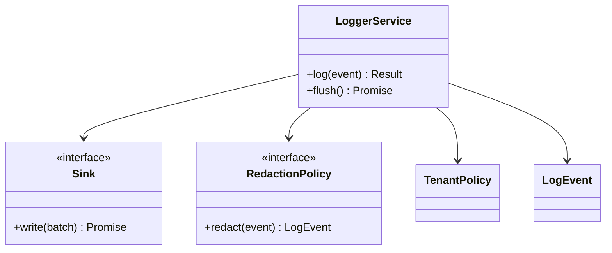

# Distributed Logger — TypeScript LLD Exercise

Design a logger ingestion pipeline with structured events, batching, redaction, tenant quotas, sinks and retry behavior.

## Model
LogEvent, TenantPolicy, IngestBatch, Parser, RedactionPolicy, Sink interface, RetentionPolicy, LoggerService and QueryFilter.

## Diagram

## Implementation
Use readonly event types, injected clock/sink, bounded batch size and queue, explicit flush/close lifecycle, redaction before sink writes, and typed retryable/permanent errors. Avoid unbounded buffering.

## Tests
Batch thresholds; flush/close; sink timeout/retry; poison event handling; redaction; tenant quota; duplicate batch ID; backpressure; clock/timestamp behavior.

## Interview prompts
Push vs pull? Where does durability begin? How prevent noisy tenants? How handle poison records and cardinality?
