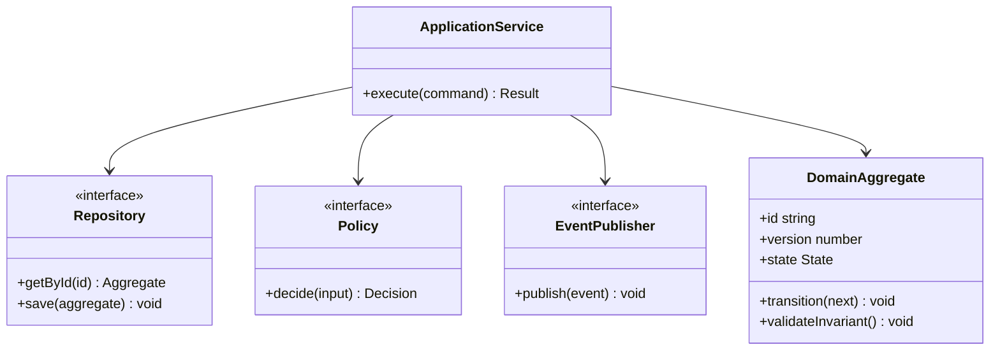
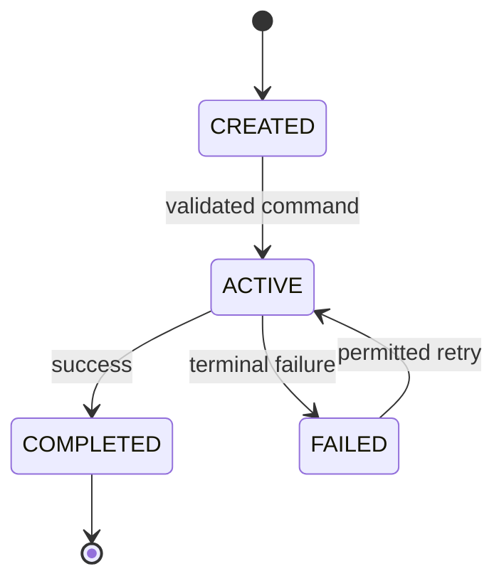

# Streaming Platform — LLD Exercise

Profile, Title, Season, Episode, Entitlement, PlaybackSession, Manifest and License. Model entitlement, heartbeat, resume position and device concurrency.

## Design goals
- Keep domain rules independent from HTTP, database and provider adapters.
- Express invariants in constructors and intent-revealing methods.
- Use interfaces for real variation points; avoid speculative abstractions.
- Make state transitions explicit and reject invalid transitions.
- Treat concurrency and idempotency as part of the contract.

## Class diagram

## State lifecycle

Adapt state labels to the domain lifecycle. Document forbidden transitions and terminal states.

## Command flow
1. Validate command shape and actor identity.
2. Load aggregate; check optimistic version and idempotency key.
3. Apply a domain method that enforces invariants.
4. Persist aggregate and outbox event atomically.
5. Publish asynchronously; consumers deduplicate by event ID.

## TypeScript implementation direction
Use private state, discriminated unions, readonly value objects, injected interfaces and explicit Result/error types. Keep I/O in adapters.

Suggested files: `domain/aggregate.ts, application/service.ts, ports.ts, tests/aggregate.test.ts`.

## Required tests
- Happy path and each allowed transition.
- Invalid transition and invariant violation.
- Duplicate command/idempotency replay.
- Concurrent update (optimistic version conflict).
- Provider timeout/retry boundary.
- Expiry, ordering, malformed input and authorization boundary tests.

## Interview prompts
- Which object owns the invariant and why?
- What should be an entity, value object, policy or service?
- Where is State, Strategy, Adapter, Observer or Repository justified?
- How do you prevent two concurrent commands from both winning?
- What is the smallest design that satisfies the requirements?
