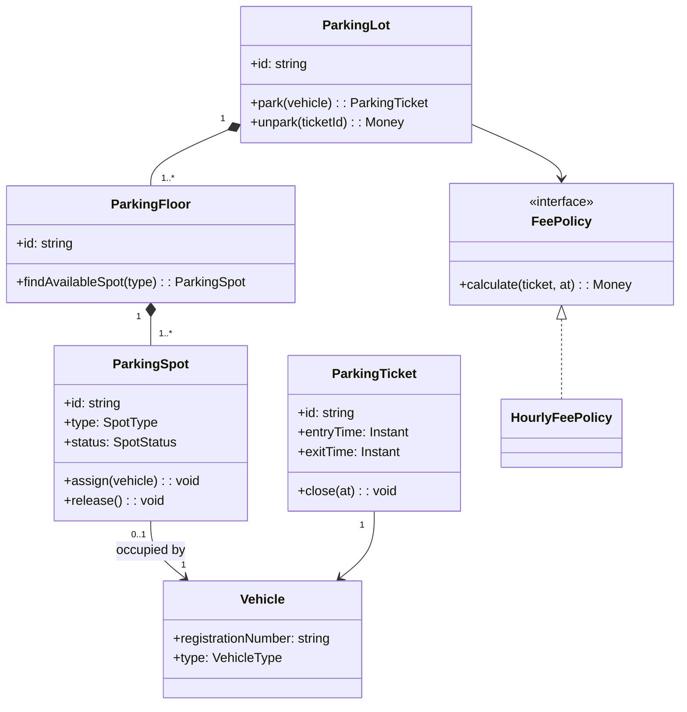
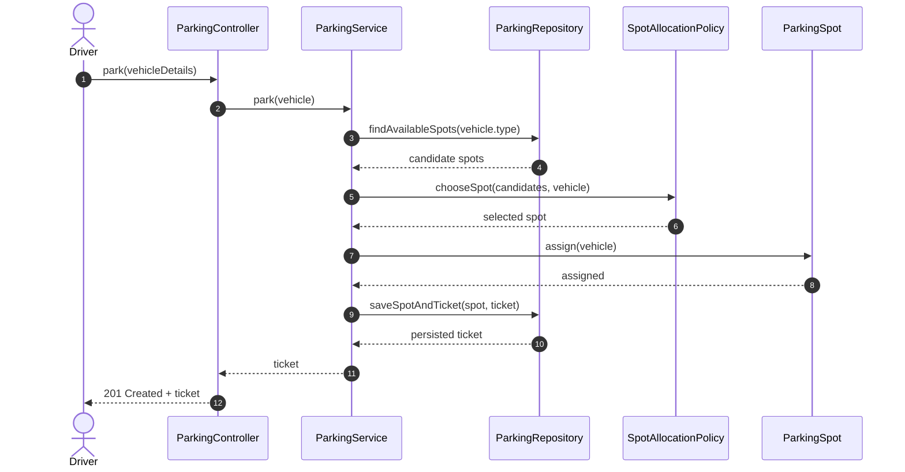
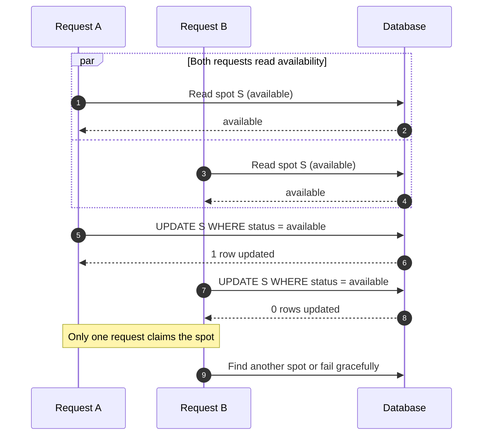
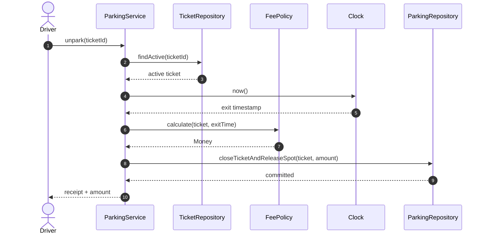

# LLD Interview Problem-Solving Playbook

This playbook teaches a repeatable way to take an ambiguous object-oriented design prompt from conversation to a defendable design and implementation. It complements the pattern catalogue: **do not start by naming a pattern or drawing classes**. Start by understanding the problem.

> Interview objective: make your reasoning visible. A good design is not just a class diagram; it is a chain of justified decisions.

## The end-to-end workflow

1. Clarify scope, business rules, constraints, and success criteria.
2. Extract candidate domain entities, value objects, and actors.
3. Identify responsibilities and relationships.
4. Walk through the most important use cases.
5. Draw a small class diagram and one or more sequence diagrams.
6. Design class APIs and implement the simplest correct version.
7. Apply SOLID where it improves changeability and testability.
8. Introduce a pattern only when a concrete variation or collaboration problem justifies it.
9. Challenge the design with edge cases, failures, and concurrency.
10. Summarize trade-offs and possible next evolutions.


## 1. Clarify before designing

Spend the first few minutes narrowing the problem. Ask questions that change the model, invariants, or complexity—not questions whose answers do not affect your design.

### A. Scope and actors
- Who uses the system: customer, operator, administrator, external service, or another system?
- What are the primary user journeys?
- Which operations are in scope for this interview, and which are explicitly out of scope?
- Is this a single-location/single-process design or should we model multiple locations, services, or instances?
- Are there roles and permissions that change what an actor can do?

### B. Business rules and invariants
- What makes an operation valid or invalid?
- What must always be true? For example, can a seat be confirmed for at most one booking?
- Are transitions constrained by a lifecycle/state machine?
- Can an operation be cancelled, reversed, refunded, or retried?
- Are there business limits, grace periods, expiry rules, or prioritisation rules?

### C. Data and identity
- What uniquely identifies each domain object?
- Which data is required versus optional?
- Do we need to retain history/audit events?
- Can records be deleted, or must they be archived?
- Are duplicate requests possible? Is there an idempotency key?

### D. Scale, timing, and concurrency
- Expected number of users, requests, objects, and peak load?
- Can two users act on the same resource concurrently?
- Are operations synchronous, asynchronous, or a mix?
- What are the latency and availability expectations?
- Is eventual consistency acceptable anywhere?

### E. Integrations and failure behaviour
- Are payment, messaging, storage, or identity providers involved?
- What happens when an integration times out or returns an ambiguous result?
- Should we retry? Which errors are retryable?
- Is there a compensation action if a later step fails?
- What should the user see while work is pending?

### F. Constraints and evaluation
- Which language and level of implementation detail are expected?
- Should persistence be in-memory, SQL, or an abstraction?
- Are external libraries/frameworks allowed?
- Should we optimise for extensibility, low latency, correctness, or simplicity first?

### A useful clarification script

Say:

> “I’ll first pin down the core use cases and invariants. Then I’ll model the domain and walk through the happy path. I’ll keep the first version simple and call out where concurrency or failure handling changes the design.”

Do not interrogate the interviewer with every question. Ask the few that materially change the design, state reasonable assumptions for the rest, and invite correction.

### Clarification decision table

| Question | Why it changes the design |
|---|---|
| Can two users claim the same resource? | Requires atomic allocation / conflict handling |
| Can requests be retried? | Requires idempotency and duplicate detection |
| Does a hold expire? | Introduces time-based state transitions |
| Can external calls time out ambiguously? | Requires reconciliation, not blind retry |
| Can new policies/channels be added? | May justify an interchangeable policy/strategy abstraction |
| Must work survive process restart? | Requires durable persistence rather than in-memory state |

## 2. Find entities without turning every noun into a class

Read the prompt and extract nouns, verbs, rules, and states.

- **Nouns** are candidate entities or value objects: User, Vehicle, ParkingSpot, Ticket.
- **Verbs** are candidate behaviours/use cases: park, assign, calculate fee, release.
- **Rules** become invariants or policies: one active vehicle per spot; fee rounds up by hour.
- **States** suggest lifecycle models: Available, Occupied, Reserved, OutOfService.

Not every noun deserves a class. A class should have identity, behaviour, lifecycle, or a meaningful responsibility. Simple descriptive data may be a value object.

### Entity versus value object

| Concept | Entity | Value object |
|---|---|---|
| Identity | Has stable identity | Defined by its values |
| Equality | Same ID means same entity | Same values means equivalent |
| Mutation | May change over lifecycle | Prefer immutable |
| Examples | Booking, User, Vehicle | Money, TimeRange, Address |

### Entity discovery checklist
1. Who owns or changes this data?
2. Does it have an identity across time?
3. Does it have a lifecycle or state transitions?
4. Does it enforce a business invariant?
5. Is it just a value used by another object?

If an object only stores fields and has no domain meaning, do not create it automatically. If a concept owns a rule, consider giving it the behaviour rather than placing all logic in a manager/service.

### Worked example: Parking Lot

Prompt: “Design a parking lot that can park vehicles, issue tickets, and calculate fees.”

| Candidate | Classification | Reason |
|---|---|---|
| ParkingLot | Aggregate/root or coordinating domain object | Owns floors and lot-level operations |
| ParkingFloor | Entity | Has identity and contains spots |
| ParkingSpot | Entity | Has identity, type, and occupancy state |
| Vehicle | Entity | Has identity/registration and type |
| ParkingTicket | Entity | Has lifecycle and entry/exit timestamps |
| Money | Value object | Amount and currency should travel together |
| FeePolicy | Policy/abstraction | Pricing can vary without rewriting ticket flow |
| ParkingManager | Application service | Coordinates a use case; should not own every business rule |

A possible relationship sketch:



Read the multiplicities aloud. A lot contains floors; a floor owns spots; a spot may be occupied by at most one vehicle; a ticket refers to the vehicle for a parking session.

## 3. Draw relationships deliberately

Use relationships to communicate ownership, lifetime, and collaboration—not merely to connect every class.

| Relationship | Meaning | Example |
|---|---|---|
| Association | One object knows/uses another | Ticket references Vehicle |
| Aggregation | Whole groups parts; parts can exist independently | Team and Player (depending on domain rules) |
| Composition | Whole owns part lifecycle | ParkingFloor and its ParkingSpots |
| Inheritance | “Is-a” substitutability | CardPayment is a PaymentMethod |
| Realisation | Class implements interface | HourlyFeePolicy implements FeePolicy |
| Dependency | Temporary use | ParkingManager calls Clock |

### Relationship questions
- Who creates the object?
- Who owns its lifecycle?
- Can the child exist independently?
- Is the relationship one-to-one, one-to-many, or optional?
- Is this inheritance truly substitutable, or would composition be safer?
- Is this a persistent relationship or only a temporary dependency?

Prefer composition over inheritance when behaviour varies independently. Avoid deep inheritance trees and avoid bidirectional references unless there is a real query/use-case need.

## 4. Turn responsibilities into classes and APIs

Use responsibility-first design:

1. List use cases and their steps.
2. Assign each business rule to the object that has the information needed to enforce it.
3. Keep orchestration in an application service.
4. Keep external IO behind interfaces/adapters.
5. Define small public methods that express domain intent.
6. Make illegal state transitions hard to perform.

### Example responsibility allocation

| Responsibility | Good home | Avoid |
|---|---|---|
| Validate a spot can accept a vehicle | ParkingSpot | Controller with direct field mutation |
| Find a suitable spot | SpotAllocationPolicy / floor query | Fee calculator |
| Calculate parking charge | FeePolicy | Ticket entity doing provider IO |
| Coordinate park workflow | ParkingService | One giant God class |
| Read/write records | ParkingRepository | Domain entity opening database connections |
| Obtain current time | Clock abstraction | Scattered calls to system clock |

### Class design template

```ts
// Domain model: owns an invariant and exposes intent-focused methods.
export class ParkingSpot {
  private vehicleId?: string;

  constructor(
    public readonly id: string,
    public readonly type: SpotType,
  ) {}

  get isAvailable(): boolean {
    return this.vehicleId === undefined;
  }

  assign(vehicle: Vehicle): void {
    if (!this.isAvailable) {
      throw new Error("Spot is already occupied");
    }
    if (!this.canFit(vehicle)) {
      throw new Error("Vehicle cannot fit in this spot");
    }
    this.vehicleId = vehicle.id;
  }

  release(): void {
    if (this.isAvailable) {
      throw new Error("Spot is already empty");
    }
    this.vehicleId = undefined;
  }

  private canFit(vehicle: Vehicle): boolean {
    // Keep the fit rule near the spot/vehicle type decision.
    return vehicle.requiredSpotTypes.includes(this.type);
  }
}
```

The key idea is encapsulation: callers ask the object to perform a valid operation rather than changing its internal fields directly. In a production system, these in-memory checks must be paired with transaction/locking guarantees at the persistence boundary.

## 5. Apply SOLID as design tests, not a checklist

### S — Single Responsibility Principle
A class should have one cohesive reason to change. Separate fee calculation from spot allocation and persistence because those policies change for different reasons.

### O — Open/Closed Principle
New behaviour should be addable with minimal modification to stable code. A FeePolicy interface can support hourly, flat, or event pricing. Do not introduce an interface for a single implementation with no credible variation.

### L — Liskov Substitution Principle
An implementation must honour the contract of its abstraction. If a subclass throws “not supported” for a base-class method, the abstraction may be wrong. Use capability-specific interfaces or composition.

### I — Interface Segregation Principle
Clients should depend only on operations they use. Prefer `ReadableRepository` and `WritableRepository` where clients have different needs over one huge interface.

### D — Dependency Inversion Principle
High-level policy should depend on abstractions, not low-level details. Inject `ParkingRepository`, `FeePolicy`, and `Clock`; keep SQL, Redis, and wall-clock details in adapters.

### SOLID review prompts
- Can I explain the reason this class changes?
- Can I add a new policy without editing the core workflow?
- Can every implementation safely honour the same contract?
- Are interfaces smaller than the use cases that consume them?
- Can I test the domain without a database, network, or real clock?

## 6. Add patterns only when the design asks for one

A pattern is a named solution to a recurring design pressure. It is not a mandatory interview decoration.

| Design pressure | Pattern candidate | Example |
|---|---|---|
| Pricing/allocation algorithm varies | Strategy | Hourly vs flat pricing |
| Creation rules are complex | Factory | Create payment method from validated request |
| State-dependent behaviour is growing | State | Booking lifecycle |
| Need to notify independent consumers | Observer / Pub-Sub | Booking confirmed event |
| Need to hide a complex subsystem | Facade | Payment orchestration API |
| Need to adapt a third-party API | Adapter | External payment provider |
| Need to control access/caching | Proxy / Decorator | Cached repository |
| Need to construct a complex object stepwise | Builder | Search/query configuration |

### Pattern introduction test
Before adding a pattern, say:
- What varies?
- What is coupled today?
- Which change becomes easier?
- What new complexity does the abstraction introduce?
- Would a simple function or composition solve this more clearly?

**Interview narration:** “I’m introducing Strategy because pricing rules vary independently from the parking workflow. The workflow depends on the FeePolicy contract, while each strategy owns its own calculation. I would not introduce more patterns until another variation requires them.”

## 7. Sequence diagrams: tell the story of a use case

Class diagrams show static structure. Sequence diagrams show runtime collaboration, order, and failure branches. Draw the happy path first, then add the most consequential alternate paths.

### Parking a vehicle



### What if allocation races?

The sequence above is a conceptual flow. Two application instances can both read the same available spot. A real persistence adapter needs an atomic conditional update, unique constraint, row lock, or equivalent transaction. If the claim loses, retry selection or return “no spot available”; never assume an in-process check alone prevents cross-process races.



### Unparking and fee calculation



If the commit fails, the operation must not report success. Consider whether closing the ticket and releasing the spot must be one transaction. Injecting a Clock makes tests deterministic.

## 8. Edge cases: turn vague robustness into concrete scenarios

For every use case, challenge inputs, state, time, dependencies, and concurrency.

### Parking Lot edge-case matrix

| Category | Scenario | Expected behaviour / question |
|---|---|---|
| Validation | Unknown vehicle type | Reject with a clear validation error |
| Validation | Missing/blank registration | Reject before allocation |
| Capacity | No compatible spot | Return a domain-level “full” result |
| State | Assign an occupied spot | Reject; do not overwrite occupant |
| State | Release an already empty spot | Reject or make explicitly idempotent |
| Lifecycle | Unpark unknown ticket | Not found; no state mutation |
| Lifecycle | Unpark closed ticket twice | Return prior receipt or reject; decide and document |
| Time | Exit before entry | Reject invalid time range |
| Pricing | Exactly one hour / one millisecond over | Verify rounding rule explicitly |
| Pricing | Negative or zero rate | Validate policy configuration |
| Concurrency | Two cars claim one spot | Exactly one claim succeeds |
| Persistence | DB fails while ticket is saved | Roll back spot assignment |
| Retry | Client retries after timeout | Idempotency prevents duplicate ticket |
| Security | User closes another user's ticket | Authorise ownership/role |
| Operations | Clock/time zone changes | Use a consistent instant/time-zone policy |

### Edge-case review checklist
- Null, missing, malformed, and boundary values
- Empty collections and maximum capacity
- Duplicate requests and retries
- Invalid state transitions
- Concurrent updates and race conditions
- Time boundaries, expiry, and daylight-saving/time-zone concerns
- Partial failure between multiple writes
- External timeout with unknown outcome
- Permission and tenant boundaries
- Observability: what is logged, measured, and traceable?

For each scenario, write an expected outcome. “Handle errors” is not a test case.

## 9. Tests should mirror the invariants

Organise tests around observable behaviour, not private implementation details:
- Entity tests: invalid transitions are rejected.
- Policy tests: boundary values and rounding rules are deterministic.
- Service tests: collaborators are called in the correct business flow.
- Repository/integration tests: transaction and uniqueness guarantees hold.
- Concurrency tests: competing claims cannot both succeed.

Prefer injected dependencies such as `Clock`, repositories, and policy interfaces. Avoid sleeps in tests; control time explicitly.

## 10. How to communicate while drawing

Use this narration as you work:

1. “Here are the assumptions I’m making; please correct any that change the requirements.”
2. “These are the core entities. I’ve kept Money as a value object and the fee rule as a policy.”
3. “This relationship is composition because the floor owns the lifecycle of its spots.”
4. “The service orchestrates the use case; the entity still enforces its own invariant.”
5. “I’m applying Strategy because this behaviour is expected to vary independently.”
6. “This diagram is the happy path. The key race is two requests claiming the same spot, so I’ll add an atomic persistence operation.”
7. “These are the edge cases I’d test before extending this to a distributed deployment.”

### A 45-minute practice timebox

| Time | Focus | Output |
|---|---|---|
| 0–5 min | Clarify | Assumptions + scope |
| 5–10 min | Domain model | Entities, value objects, rules |
| 10–17 min | Relationships | Class diagram |
| 17–25 min | Behaviour | Happy-path sequence diagram |
| 25–33 min | Code | Core classes + interfaces |
| 33–40 min | Quality | SOLID, patterns, edge cases |
| 40–45 min | Summary | Trade-offs + next evolution |

Do not rush to complete every class. A smaller design whose invariants and trade-offs you can defend is stronger than a large diagram you cannot explain.

## Further reading in this repository

- [Existing interview playbook](../INTERVIEW_GUIDE.md)
- [60-minute mock interview](../GUIDE.md)
- [One-page cheat sheet](../MASTER_LLD_CHEAT_SHEET_ONE_PAGE.md)
- [Parking Lot implementation](../Typescript/parking-lot/README.md)
- [Parking Lot design notes](../Python/parking-lot/DESIGN.md)
