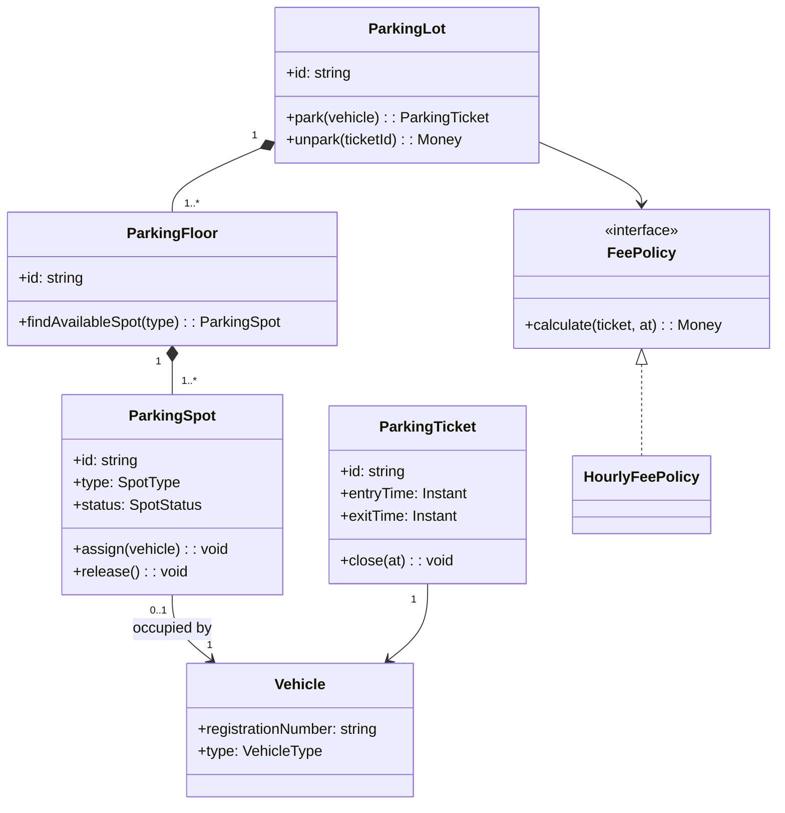
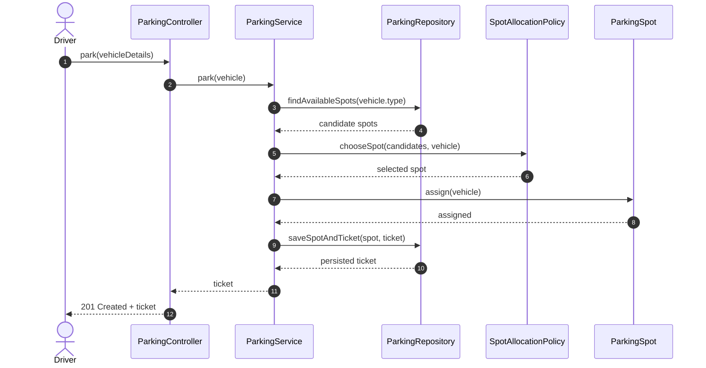
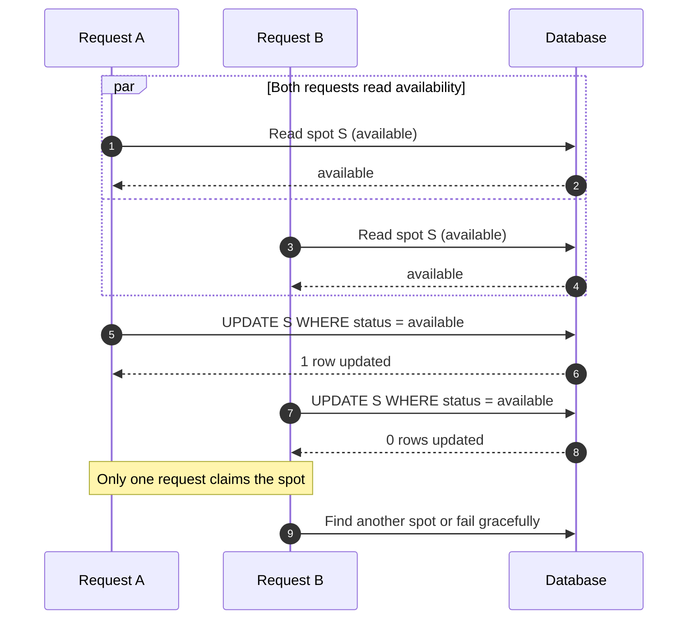
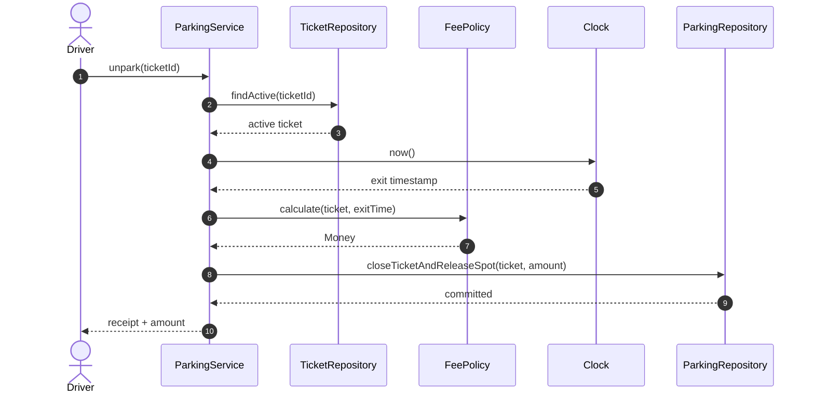

# LLD Interview Problem-Solving Playbook

This playbook teaches a repeatable way to take an ambiguous object-oriented design prompt from conversation to a defendable design and implementation. It complements the pattern catalogue: **do not start by naming a pattern or drawing classes**. Start by understanding the problem.

> Interview objective: make your reasoning visible. A good design is not just a class diagram; it is a chain of justified decisions.

## End-to-end workflow

1. Clarify scope, business rules, constraints, and success criteria.
2. Extract domain entities, value objects, and actors.
3. Identify responsibilities and relationships.
4. Walk through the important use cases.
5. Draw a class diagram and sequence diagram.
6. Design class APIs and implement the simplest correct version.
7. Apply SOLID where it improves changeability and testability.
8. Introduce patterns only when a concrete variation justifies them.
9. Challenge the design with edge cases, failures, and concurrency.
10. Summarise trade-offs and possible next evolutions.

## 1. Clarify before designing

Spend the first few minutes narrowing the problem. Ask questions that change the model, invariants, or complexity—not questions whose answers do not affect your design.

### Scope and actors
- Who uses the system: customer, operator, administrator, external service, or another system?
- What are the primary user journeys?
- Which operations are in scope, and which are out of scope?
- Is this single-process/single-location or multiple instances/locations?
- Are there roles and permissions?

### Business rules and invariants
- What makes an operation valid or invalid?
- What must always be true? Can one seat be confirmed for at most one booking?
- Are state transitions constrained by a lifecycle?
- Can an operation be cancelled, reversed, refunded, or retried?
- Are there limits, grace periods, expiry rules, or prioritisation rules?

### Data and identity
- What uniquely identifies each domain object?
- Which fields are required versus optional?
- Must history/audit events be retained?
- Can records be deleted or only archived?
- Can duplicate requests happen? Is an idempotency key required?

### Scale, timing, and concurrency
- Expected users, requests, objects, and peak load?
- Can two users act on the same resource concurrently?
- Are operations synchronous, asynchronous, or mixed?
- What are latency and availability expectations?
- Is eventual consistency acceptable anywhere?

### Integrations and failure behaviour
- Are payment, messaging, storage, or identity providers involved?
- What happens when an integration times out or returns an ambiguous result?
- Which errors are retryable?
- Is compensation required if a later step fails?
- What should the user see while work is pending?

### Constraints and evaluation
- Which language and implementation depth are expected?
- Should persistence be in-memory, SQL, or abstracted?
- Are libraries/frameworks allowed?
- Should we optimise for extensibility, latency, correctness, or simplicity first?

### Clarification script

> “I’ll first pin down the core use cases and invariants. Then I’ll model the domain and walk through the happy path. I’ll keep the first version simple and call out where concurrency or failure handling changes the design.”

Do not interrogate the interviewer with every possible question. Ask the few that materially change the design, state reasonable assumptions for the rest, and invite correction.

| Question | Why it changes the design |
|---|---|
| Can two users claim the same resource? | Atomic allocation / conflict handling |
| Can requests be retried? | Idempotency and duplicate detection |
| Does a hold expire? | Time-based state transitions |
| Can external calls time out ambiguously? | Reconciliation, not blind retry |
| Can policies/channels be added? | May justify a policy/strategy abstraction |
| Must work survive restart? | Durable persistence rather than in-memory state |

## 2. Find entities without turning every noun into a class

Read the prompt and extract **nouns, verbs, rules, and states**.

- Nouns are candidate entities/value objects: User, Vehicle, ParkingSpot, Ticket.
- Verbs are candidate behaviours/use cases: park, assign, calculate fee, release.
- Rules become invariants/policies: one active vehicle per spot; fee rounds up by hour.
- States suggest lifecycle models: Available, Occupied, Reserved, OutOfService.

Not every noun deserves a class. A class should have identity, behaviour, lifecycle, or a meaningful responsibility. Descriptive data may be a value object.

### Entity versus value object

| Concept | Entity | Value object |
|---|---|---|
| Identity | Stable identity | Defined by values |
| Equality | Same ID means same entity | Same values means equivalent |
| Mutation | May change over lifecycle | Prefer immutable |
| Examples | Booking, User, Vehicle | Money, TimeRange, Address |

Ask: Who owns or changes this data? Does it have identity over time? Does it have a lifecycle? Does it enforce an invariant? Is it simply a value used by another object?

### Worked example: Parking Lot

Prompt: “Design a parking lot that can park vehicles, issue tickets, and calculate fees.”

| Candidate | Classification | Reason |
|---|---|---|
| ParkingLot | Aggregate/root or coordinating domain object | Owns floors and lot-level operations |
| ParkingFloor | Entity | Has identity and contains spots |
| ParkingSpot | Entity | Has identity, type, and occupancy state |
| Vehicle | Entity | Has identity/registration and type |
| ParkingTicket | Entity | Has lifecycle and entry/exit timestamps |
| Money | Value object | Amount and currency travel together |
| FeePolicy | Policy abstraction | Pricing varies without rewriting ticket flow |
| ParkingService | Application service | Coordinates the use case, not every business rule |

A possible relationship sketch:



Read multiplicities aloud. A lot contains floors; a floor owns spots; a spot is occupied by at most one vehicle; a ticket refers to the vehicle for a parking session.

## 3. Draw relationships deliberately

Relationships communicate ownership, lifetime, and collaboration—not merely that two classes know each other.

| Relationship | Meaning | Example |
|---|---|---|
| Association | One object knows/uses another | Ticket references Vehicle |
| Aggregation | Whole groups parts; parts can exist independently | Team and Player (domain-dependent) |
| Composition | Whole owns part lifecycle | ParkingFloor and ParkingSpots |
| Inheritance | Is-a substitutability | CardPayment is a PaymentMethod |
| Realisation | Class implements interface | HourlyFeePolicy implements FeePolicy |
| Dependency | Temporary use | ParkingManager calls Clock |

Ask: Who creates it? Who owns its lifecycle? Can the child exist independently? Is the relationship optional or one-to-many? Is inheritance genuinely substitutable? Prefer composition when behaviour varies independently; avoid deep inheritance and unnecessary bidirectional references.

## 4. Turn responsibilities into classes and APIs

Use responsibility-first design:
1. List use cases and their steps.
2. Assign each business rule to the object with the information needed to enforce it.
3. Keep orchestration in an application service.
4. Put external IO behind interfaces/adapters.
5. Define small public methods that express domain intent.
6. Make invalid state transitions difficult to perform.

| Responsibility | Good home | Avoid |
|---|---|---|
| Validate spot accepts vehicle | ParkingSpot | Controller mutating fields |
| Find suitable spot | SpotAllocationPolicy / floor query | Fee calculator |
| Calculate charge | FeePolicy | Ticket doing provider IO |
| Coordinate park workflow | ParkingService | One giant God class |
| Read/write records | ParkingRepository | Domain entity opening DB connections |
| Obtain current time | Clock abstraction | Scattered system clock calls |

### Example class with intent-focused methods

```ts
// Domain model: owns the occupancy invariant.
export class ParkingSpot {
  private vehicleId?: string;

  constructor(
    public readonly id: string,
    public readonly type: SpotType,
  ) {}

  // Derive availability from state rather than storing two fields
  // that could contradict each other.
  get isAvailable(): boolean {
    return this.vehicleId === undefined;
  }

  assign(vehicle: Vehicle): void {
    if (!this.isAvailable) {
      throw new Error("Spot is already occupied");
    }
    if (!this.canFit(vehicle)) {
      throw new Error("Vehicle cannot fit in this spot");
    }
    this.vehicleId = vehicle.id;
  }

  release(): void {
    if (this.isAvailable) {
      throw new Error("Spot is already empty");
    }
    this.vehicleId = undefined;
  }

  private canFit(vehicle: Vehicle): boolean {
    // Keep the fit decision close to the domain model.
    return vehicle.requiredSpotTypes.includes(this.type);
  }
}
```

Callers ask the object to perform a valid operation rather than changing internal fields directly. In production, pair in-memory checks with transaction/locking guarantees at the persistence boundary.

## 5. Apply SOLID as design tests, not a checklist

- **S — Single Responsibility:** one cohesive reason to change. Separate fee calculation from allocation and persistence because those rules change independently.
- **O — Open/Closed:** add behaviour with minimal edits to stable code. FeePolicy can support hourly, flat, or event pricing. Do not create an interface for imaginary variation.
- **L — Liskov Substitution:** implementations honour the abstraction contract. If a subclass throws “not supported” for a base method, rethink the abstraction.
- **I — Interface Segregation:** clients depend only on operations they use. Prefer small readable/writable interfaces where clients differ.
- **D — Dependency Inversion:** high-level policy depends on abstractions. Inject ParkingRepository, FeePolicy, and Clock; put SQL, Redis, and system time in adapters.

SOLID review prompts:
- Can I explain why this class changes?
- Can I add a new policy without editing the core workflow?
- Can every implementation honour the same contract?
- Are interfaces smaller than the use cases consuming them?
- Can I test the domain without a DB, network, or real clock?

## 6. Add patterns only when the design asks for one

A pattern is a named solution to a recurring design pressure, not an interview decoration.

| Design pressure | Pattern candidate | Example |
|---|---|---|
| Pricing/allocation algorithm varies | Strategy | Hourly vs flat pricing |
| Creation rules are complex | Factory | Create payment method from validated request |
| State-dependent behaviour is growing | State | Booking lifecycle |
| Notify independent consumers | Observer / Pub-Sub | Booking confirmed event |
| Hide a complex subsystem | Facade | Payment orchestration API |
| Adapt a third-party API | Adapter | External payment provider |
| Control access/caching | Proxy / Decorator | Cached repository |
| Build complex object stepwise | Builder | Search/query configuration |

Before adding one, ask: What varies? What is coupled today? Which change becomes easier? What complexity does the abstraction add? Would a simple function or composition be clearer?

> “I’m introducing Strategy because pricing rules vary independently from the parking workflow. The workflow depends on FeePolicy, while each strategy owns its calculation. I’ll add no more patterns until another variation requires them.”

## 7. Sequence diagrams explain runtime collaboration

Class diagrams show static structure. Sequence diagrams show runtime collaboration, order, and failure branches. Draw the happy path, then the consequential alternate paths.

### Parking a vehicle



### Concurrency: two requests claim the same spot

The happy-path sequence is conceptual. Two instances can both read the same spot as available. A real persistence adapter needs an atomic conditional update, unique constraint, row lock, or equivalent transaction.



### Unparking and fee calculation



If the commit fails, do not report success. Decide whether closing the ticket and releasing the spot must be one transaction. Injecting Clock makes tests deterministic.

## 8. Edge cases: turn robustness into concrete scenarios

| Category | Scenario | Expected behaviour / question |
|---|---|---|
| Validation | Unknown vehicle type | Reject clearly |
| Validation | Missing/blank registration | Reject before allocation |
| Capacity | No compatible spot | Return domain-level “full” result |
| State | Assign occupied spot | Reject; do not overwrite occupant |
| State | Release empty spot | Reject or explicitly make idempotent |
| Lifecycle | Unknown ticket | Not found; no mutation |
| Lifecycle | Close same ticket twice | Return prior receipt or reject; decide/document |
| Time | Exit before entry | Reject invalid time range |
| Pricing | Exact hour / one millisecond over | Verify rounding rule |
| Pricing | Negative/zero configured rate | Validate policy configuration |
| Concurrency | Two cars claim one spot | Exactly one claim succeeds |
| Persistence | DB fails while ticket saved | Roll back spot assignment |
| Retry | Client retries after timeout | Idempotency prevents duplicate ticket |
| Security | User closes another user's ticket | Authorise ownership/role |
| Operations | Clock/time-zone changes | Use consistent instant/time-zone policy |

Review null/missing/malformed/boundary values, empty and full collections, retries, invalid transitions, concurrent updates, time boundaries, partial failures, ambiguous external outcomes, permission boundaries, and observability. For every scenario, write an expected outcome. “Handle errors” is not a test case.

## 9. Tests should mirror invariants

- Entity tests: invalid transitions are rejected.
- Policy tests: boundaries and rounding are deterministic.
- Service tests: collaborators participate in the correct business flow.
- Repository/integration tests: transaction and uniqueness guarantees hold.
- Concurrency tests: competing claims cannot both succeed.

Test observable behaviour, not private fields. Inject Clock, repositories, and policy interfaces. Avoid sleeps; control time explicitly.

## 10. Narrate your reasoning

1. “Here are my assumptions; please correct any that change the requirements.”
2. “These are the core entities. Money is a value object and fee calculation is a policy.”
3. “This is composition because the floor owns the lifecycle of its spots.”
4. “The service orchestrates the use case; the entity still enforces its invariant.”
5. “I’m using Strategy because this behaviour varies independently.”
6. “This is the happy path. The critical race is two requests claiming one spot, so persistence needs an atomic operation.”
7. “These are the edge cases I’d test before evolving this to a distributed deployment.”

### 45-minute practice timebox

| Time | Focus | Output |
|---|---|---|
| 0–5 min | Clarify | Assumptions + scope |
| 5–10 min | Domain model | Entities, values, rules |
| 10–17 min | Relationships | Class diagram |
| 17–25 min | Behaviour | Happy-path sequence |
| 25–33 min | Code | Core classes + interfaces |
| 33–40 min | Quality | SOLID, patterns, edge cases |
| 40–45 min | Summary | Trade-offs + next evolution |

A smaller design whose invariants and trade-offs you can defend is stronger than a huge diagram you cannot explain.

## Related repository guides

- [Interview Guide](../INTERVIEW_GUIDE.md)
- [60-minute Mock Interview](../GUIDE.md)
- [One-page Cheat Sheet](../MASTER_LLD_CHEAT_SHEET_ONE_PAGE.md)
- [TypeScript Parking Lot](../Typescript/parking-lot/README.md)
- [Python Parking Lot design](../Python/parking-lot/DESIGN.md)
