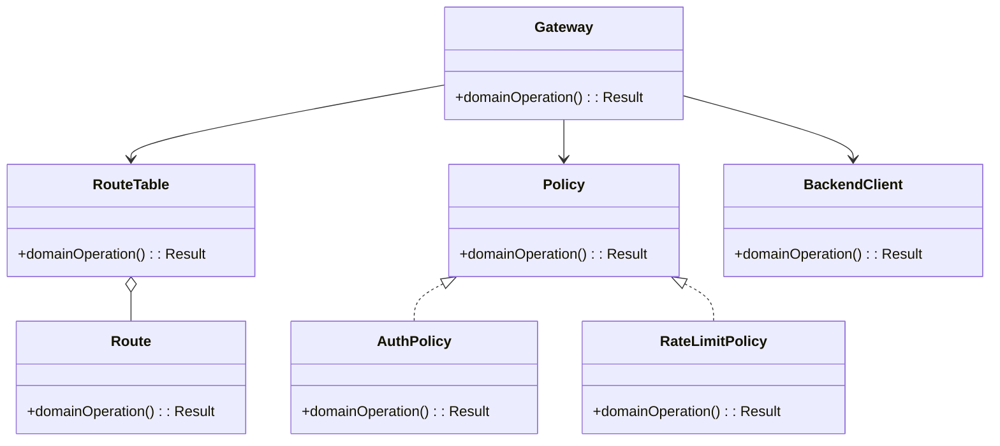
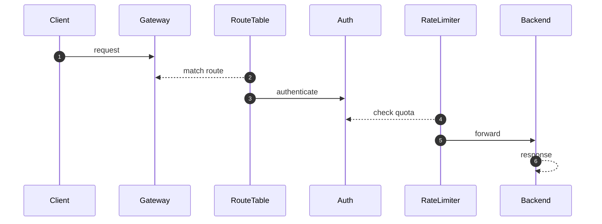

# API Gateway — LLD Interview Guide

**Problem:** Route requests and apply edge policies.

## Clarifying questions
- Routing by path/host?
- Auth at edge?
- Limit key?
- Retry safety/timeouts?
- Transform/aggregate?
- Shared state?
Ask what changes invariants, APIs or trade-offs; state assumptions for the rest.

## Entity discovery and responsibilities
Candidate concepts: Gateway, RouteTable, Route, Policy, AuthPolicy, RateLimitPolicy, BackendClient. Classify as entity (identity/lifecycle), value object (value equality), policy, application service or infrastructure port. Avoid making every noun a class.

| Class | Responsibility |
|---|---|
| `Gateway` | Own cohesive state/behaviour; keep orchestration and IO separate. |
| `RouteTable` | Own cohesive state/behaviour; keep orchestration and IO separate. |
| `Route` | Own cohesive state/behaviour; keep orchestration and IO separate. |
| `Policy` | Own cohesive state/behaviour; keep orchestration and IO separate. |
| `AuthPolicy` | Own cohesive state/behaviour; keep orchestration and IO separate. |
| `RateLimitPolicy` | Own cohesive state/behaviour; keep orchestration and IO separate. |
| `BackendClient` | Own cohesive state/behaviour; keep orchestration and IO separate. |

Keep invariants with their state owner, expose intent-focused methods, avoid public mutable fields, and inject dependencies for deterministic tests.

## Class diagram

## Sequence diagram

This is the happy path. Explain validation, persistence, atomicity, retries and failure boundaries.

## SOLID
- **S:** separate domain policy, orchestration, persistence and IO.
- **O:** extend through abstractions only for real variation.
- **L:** implementations honour behavioural/error contracts.
- **I:** ports expose only client-needed operations.
- **D:** use-case logic depends on abstractions; adapters implement infrastructure.

## Patterns that may fit
- Chain of Responsibility for policies
- Adapter for backend protocols
- Circuit Breaker for downstreams
Explain the design pressure and complexity introduced before applying a pattern.

## Edge cases and tests
1. **No route** — define expected outcome and add a focused test.
2. **Expired credentials** — define expected outcome and add a focused test.
3. **Quota exceeded** — define expected outcome and add a focused test.
4. **Backend timeout** — define expected outcome and add a focused test.
5. **Unsafe retry duplicates write** — define expected outcome and add a focused test.
6. **Header spoofing** — define expected outcome and add a focused test.
7. **Policy ordering** — define expected outcome and add a focused test.

## Senior-level trade-off
Keep domain business logic out of the gateway. Discuss multi-instance behaviour, observability, security and recovery; distinguish code guarantees from infrastructure guarantees.

## Interview wrap-up
Summarise assumptions, entities, main flow, pattern rationale, hardest edge case and one limitation/next evolution.
