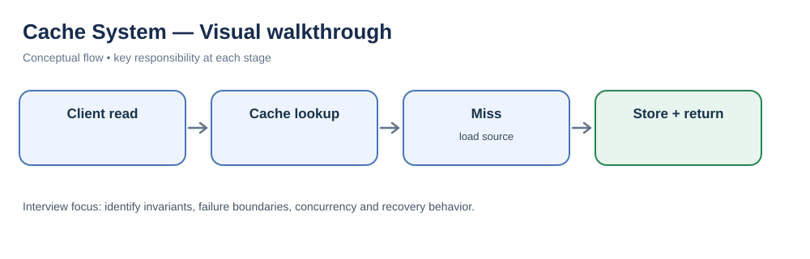
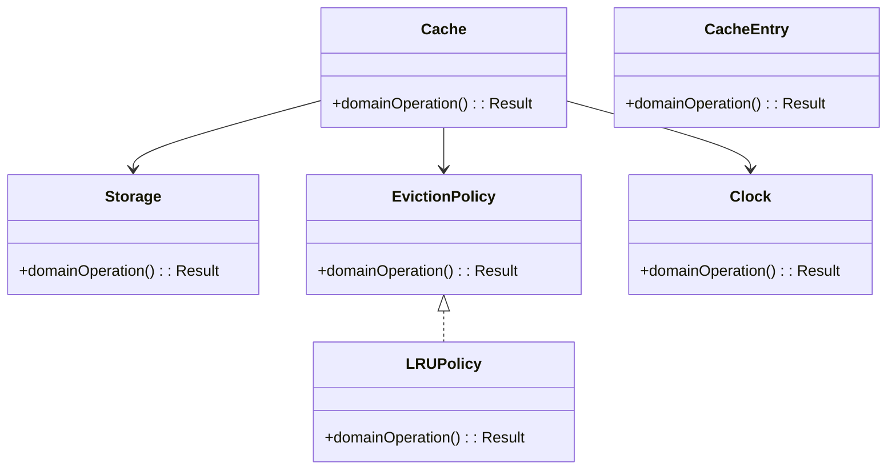
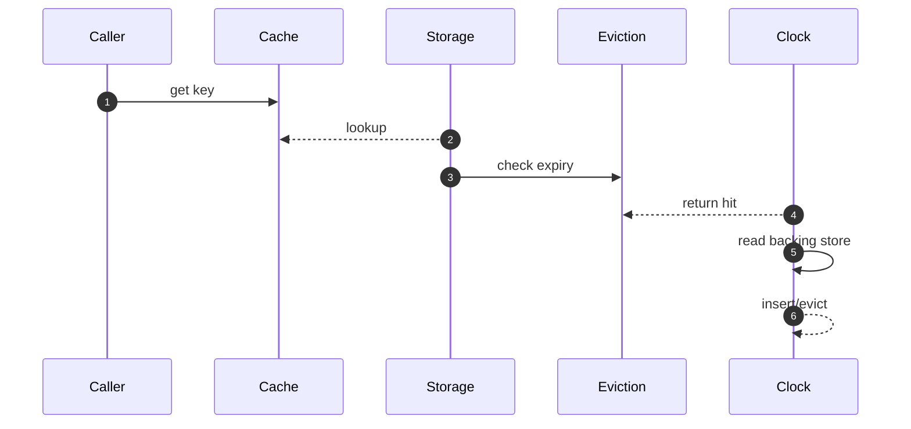

# Cache System — LLD Interview Guide

**Problem:** Fast key-value access with eviction and expiry.

## Visual walkthrough

A hit avoids the source read. A miss loads the value, populates the cache with a TTL, and returns it; invalidation policy controls staleness.

## Clarifying questions
- Local or distributed?
- LRU/LFU/FIFO?
- Fixed/sliding TTL?
- Miss/failure behaviour?
- Null vs missing?
- Consistency/invalidation?
- Concurrent semantics?
Ask what changes invariants, APIs or trade-offs; state assumptions for the rest.

## Entity discovery and responsibilities
Candidate concepts: Cache, CacheEntry, Storage, EvictionPolicy, LRUPolicy, Clock. Classify as entity (identity/lifecycle), value object (value equality), policy, application service or infrastructure port. Avoid making every noun a class.

| Class | Responsibility |
|---|---|
| `Cache` | Own cohesive state/behaviour; keep orchestration and IO separate. |
| `CacheEntry` | Own cohesive state/behaviour; keep orchestration and IO separate. |
| `Storage` | Own cohesive state/behaviour; keep orchestration and IO separate. |
| `EvictionPolicy` | Own cohesive state/behaviour; keep orchestration and IO separate. |
| `LRUPolicy` | Own cohesive state/behaviour; keep orchestration and IO separate. |
| `Clock` | Own cohesive state/behaviour; keep orchestration and IO separate. |

Keep invariants with their state owner, expose intent-focused methods, avoid public mutable fields, and inject dependencies for deterministic tests.

## Class diagram

## Sequence diagram

This is the happy path. Explain validation, persistence, atomicity, retries and failure boundaries.

## SOLID
- **S:** separate domain policy, orchestration, persistence and IO.
- **O:** extend through abstractions only for real variation.
- **L:** implementations honour behavioural/error contracts.
- **I:** ports expose only client-needed operations.
- **D:** use-case logic depends on abstractions; adapters implement infrastructure.

## Patterns that may fit
- Strategy for eviction
- Decorator for metrics
- Cache-aside integration
Explain the design pressure and complexity introduced before applying a pattern.

## Edge cases and tests
1. **Expiry boundary** — define expected outcome and add a focused test.
2. **Capacity zero** — define expected outcome and add a focused test.
3. **Eviction tie** — define expected outcome and add a focused test.
4. **Hot-key stampede** — define expected outcome and add a focused test.
5. **Concurrent put/evict** — define expected outcome and add a focused test.
6. **Stale value** — define expected outcome and add a focused test.
7. **Mutable reference** — define expected outcome and add a focused test.

## Senior-level trade-off
Define invalidation and staleness before optimising. Discuss multi-instance behaviour, observability, security and recovery; distinguish code guarantees from infrastructure guarantees.

## Interview wrap-up
Summarise assumptions, entities, main flow, pattern rationale, hardest edge case and one limitation/next evolution.
