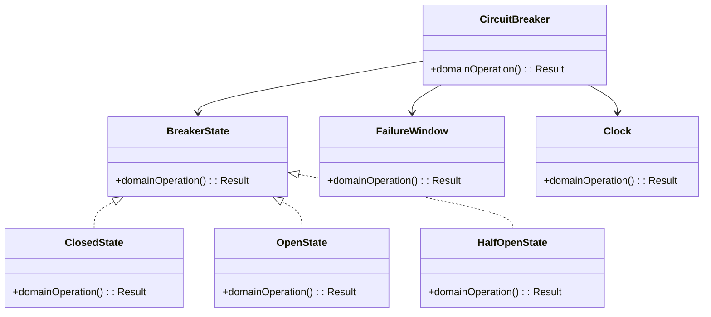
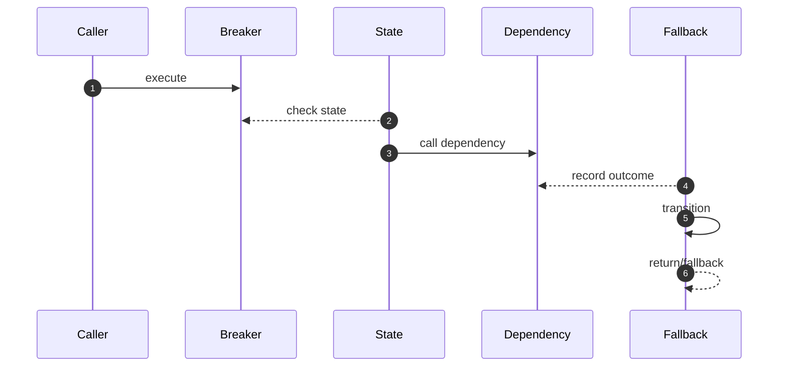

# Circuit Breaker — LLD Interview Guide

**Problem:** Stop repeated calls to failing dependencies and probe recovery.

## Clarifying questions
- Which failures count?
- Timeouts separate?
- Window/threshold?
- Open duration?
- Probe count?
- Fallback?
- Local/shared state?
Ask what changes invariants, APIs or trade-offs; state assumptions for the rest.

## Entity discovery and responsibilities
Candidate concepts: CircuitBreaker, BreakerState, ClosedState, OpenState, HalfOpenState, FailureWindow, Clock. Classify as entity (identity/lifecycle), value object (value equality), policy, application service or infrastructure port. Avoid making every noun a class.

| Class | Responsibility |
|---|---|
| `CircuitBreaker` | Own cohesive state/behaviour; keep orchestration and IO separate. |
| `BreakerState` | Own cohesive state/behaviour; keep orchestration and IO separate. |
| `ClosedState` | Own cohesive state/behaviour; keep orchestration and IO separate. |
| `OpenState` | Own cohesive state/behaviour; keep orchestration and IO separate. |
| `HalfOpenState` | Own cohesive state/behaviour; keep orchestration and IO separate. |
| `FailureWindow` | Own cohesive state/behaviour; keep orchestration and IO separate. |
| `Clock` | Own cohesive state/behaviour; keep orchestration and IO separate. |

Keep invariants with their state owner, expose intent-focused methods, avoid public mutable fields, and inject dependencies for deterministic tests.

## Class diagram

## Sequence diagram

This is the happy path. Explain validation, persistence, atomicity, retries and failure boundaries.

## SOLID
- **S:** separate domain policy, orchestration, persistence and IO.
- **O:** extend through abstractions only for real variation.
- **L:** implementations honour behavioural/error contracts.
- **I:** ports expose only client-needed operations.
- **D:** use-case logic depends on abstractions; adapters implement infrastructure.

## Patterns that may fit
- State for lifecycle
- Decorator around client
- Strategy for fallback
Explain the design pressure and complexity introduced before applying a pattern.

## Edge cases and tests
1. **Slow timeout** — define expected outcome and add a focused test.
2. **Window boundary** — define expected outcome and add a focused test.
3. **Concurrent probes** — define expected outcome and add a focused test.
4. **Probe fails** — define expected outcome and add a focused test.
5. **Business errors** — define expected outcome and add a focused test.
6. **Clock jumps** — define expected outcome and add a focused test.
7. **Fallback fails** — define expected outcome and add a focused test.

## Senior-level trade-off
Over-sensitive thresholds can amplify transient failures. Discuss multi-instance behaviour, observability, security and recovery; distinguish code guarantees from infrastructure guarantees.

## Interview wrap-up
Summarise assumptions, entities, main flow, pattern rationale, hardest edge case and one limitation/next evolution.
