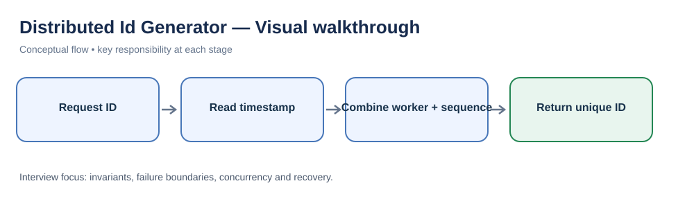
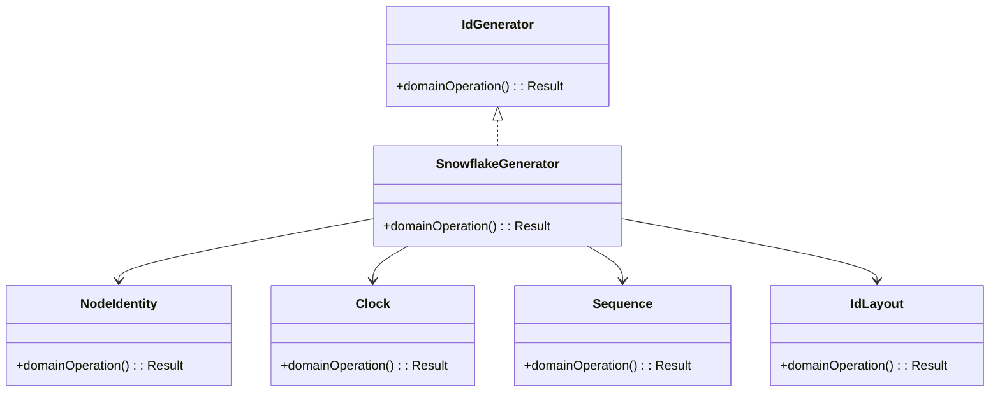
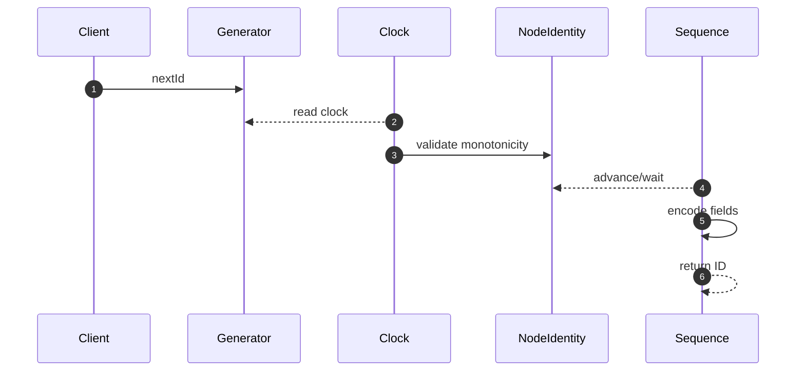

# Distributed ID Generator — LLD Interview Guide

**Problem:** Generate unique IDs across nodes with ordering and throughput requirements.

## Visual walkthrough

A Snowflake-style ID combines time, worker identity and a per-time-unit sequence. Worker coordination and clock rollback are key correctness concerns.

## Clarifying questions
- Unique vs sortable?
- IDs/sec and nodes?
- Opaque or time-based?
- ID width?
- Worker ID assignment?
- Clock rollback?
- Restart reuse?
Ask what changes invariants, APIs or trade-offs; state assumptions for the rest.

## Entity discovery and responsibilities
Candidate concepts: IdGenerator, SnowflakeGenerator, NodeIdentity, Clock, Sequence, IdLayout. Classify as entity (identity/lifecycle), value object (value equality), policy, application service or infrastructure port. Avoid making every noun a class.

| Class | Responsibility |
|---|---|
| `IdGenerator` | Own cohesive state/behaviour; keep orchestration and IO separate. |
| `SnowflakeGenerator` | Own cohesive state/behaviour; keep orchestration and IO separate. |
| `NodeIdentity` | Own cohesive state/behaviour; keep orchestration and IO separate. |
| `Clock` | Own cohesive state/behaviour; keep orchestration and IO separate. |
| `Sequence` | Own cohesive state/behaviour; keep orchestration and IO separate. |
| `IdLayout` | Own cohesive state/behaviour; keep orchestration and IO separate. |

Keep invariants with their state owner, expose intent-focused methods, avoid public mutable fields, and inject dependencies for deterministic tests.

## Class diagram

## Sequence diagram

This is the happy path. Explain validation, persistence, atomicity, retries and failure boundaries.

## SOLID
- **S:** separate domain policy, orchestration, persistence and IO.
- **O:** extend through abstractions only for real variation.
- **L:** implementations honour behavioural/error contracts.
- **I:** ports expose only client-needed operations.
- **D:** use-case logic depends on abstractions; adapters implement infrastructure.

## Patterns that may fit
- Strategy for ID format
- Factory for configuration
Explain the design pressure and complexity introduced before applying a pattern.

## Edge cases and tests
1. **Sequence overflow** — define expected outcome and add a focused test.
2. **Clock rollback** — define expected outcome and add a focused test.
3. **Duplicate worker** — define expected outcome and add a focused test.
4. **Restart stale identity** — define expected outcome and add a focused test.
5. **Epoch expiration** — define expected outcome and add a focused test.
6. **Contention** — define expected outcome and add a focused test.
7. **Serialization** — define expected outcome and add a focused test.

## Senior-level trade-off
Uniqueness depends on worker identity and clock policy. Discuss multi-instance behaviour, observability, security and recovery; distinguish code guarantees from infrastructure guarantees.

## Interview wrap-up
Summarise assumptions, entities, main flow, pattern rationale, hardest edge case and one limitation/next evolution.
