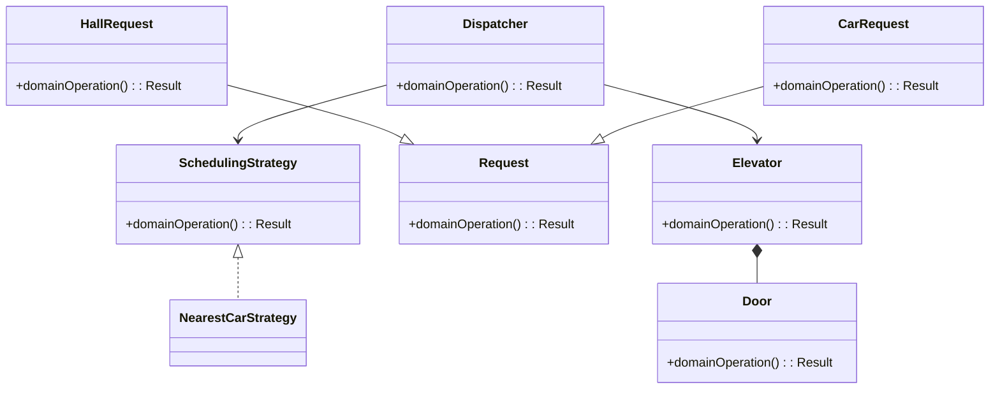
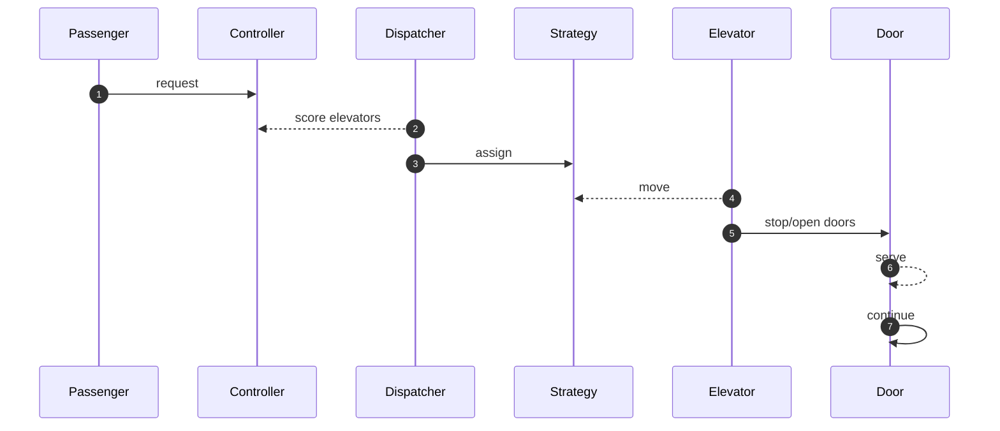

# Elevator System — LLD Interview Guide

**Problem:** Dispatch elevators balancing wait, direction and capacity.

## Clarifying questions
- Elevators/floors/zones?
- Hall vs car calls?
- Door timing?
- Direction conflict?
- Emergency/maintenance?
- Can stops be skipped?
- Wait time vs fairness?
Ask what changes invariants, APIs or trade-offs; state assumptions for the rest.

## Entity discovery and responsibilities
Candidate concepts: Elevator, Request, HallRequest, CarRequest, Dispatcher, SchedulingStrategy, Door. Classify as entity, value object, policy, application service or infrastructure port. Avoid making every noun a class.

| Class | Responsibility |
|---|---|
| `Elevator` | Own cohesive state/behaviour; keep orchestration and IO separate. |
| `Request` | Own cohesive state/behaviour; keep orchestration and IO separate. |
| `HallRequest` | Own cohesive state/behaviour; keep orchestration and IO separate. |
| `CarRequest` | Own cohesive state/behaviour; keep orchestration and IO separate. |
| `Dispatcher` | Own cohesive state/behaviour; keep orchestration and IO separate. |
| `SchedulingStrategy` | Own cohesive state/behaviour; keep orchestration and IO separate. |
| `Door` | Own cohesive state/behaviour; keep orchestration and IO separate. |

Keep invariants with their state owner, expose intent-focused methods, avoid public mutable fields, and inject dependencies for deterministic tests.

## Class diagram

## Sequence diagram

This is the happy path. Explain validation, persistence, atomicity, retries and failure boundaries.

## SOLID
- **S:** separate domain policy, orchestration, persistence and IO.
- **O:** extend through abstractions only for real variation.
- **L:** implementations honour behavioural/error contracts.
- **I:** ports expose only client-needed operations.
- **D:** use-case logic depends on abstractions; adapters implement infrastructure.

## Patterns that may fit
- Strategy for dispatch
- State for lifecycle
- Observer for status
Explain the design pressure and complexity introduced before applying a pattern.

## Edge cases and tests
1. **Current-floor request** — define expected outcome and add a focused test.
2. **Opposite-direction call** — define expected outcome and add a focused test.
3. **Full elevator** — define expected outcome and add a focused test.
4. **Door obstruction** — define expected outcome and add a focused test.
5. **Emergency stop** — define expected outcome and add a focused test.
6. **Out of service** — define expected outcome and add a focused test.
7. **Starvation** — define expected outcome and add a focused test.
8. **Simultaneous calls** — define expected outcome and add a focused test.

## Senior-level trade-off
Start with a deterministic baseline, then discuss optimisation and fairness. Discuss multi-instance behaviour, observability, security and recovery; distinguish code guarantees from infrastructure guarantees.

## Interview wrap-up
Summarise assumptions, entities, main flow, pattern rationale, hardest edge case and one limitation/next evolution.
