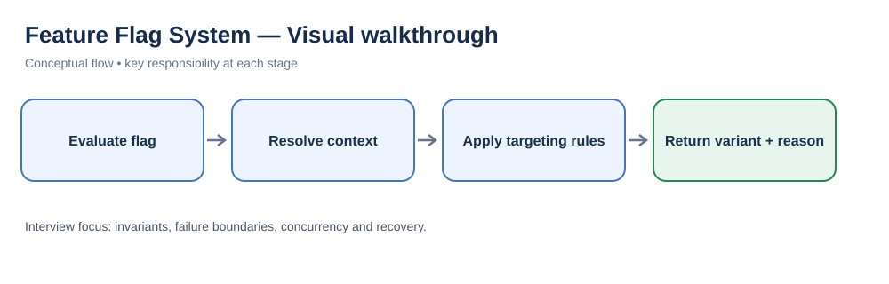
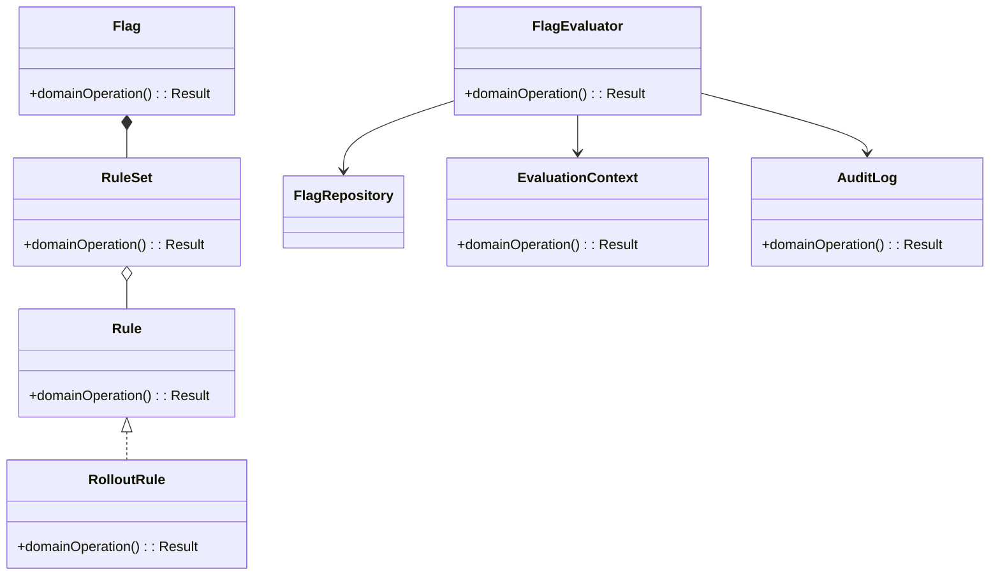
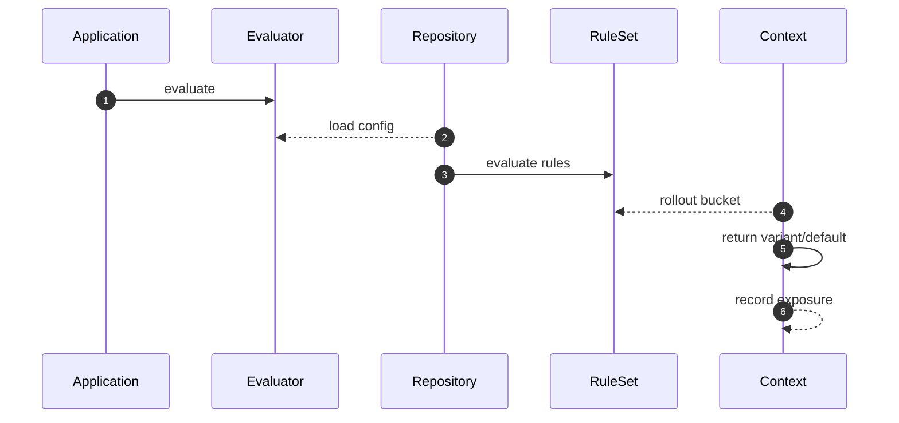

# Feature Flag System — LLD Interview Guide

**Problem:** Evaluate flags with targeting, rollout and safe defaults.

## Visual walkthrough

Evaluation combines flag configuration with user/context attributes, then returns a deterministic decision and reason for observability.

## Clarifying questions
- Flag types?
- Trusted attributes?
- Deterministic rollout?
- Failure default?
- Propagation/cache?
- Audit/approval?
- Kill-switch SLA?
Ask what changes invariants, APIs or trade-offs; state assumptions for the rest.

## Entity discovery and responsibilities
Candidate concepts: Flag, Rule, EvaluationContext, FlagEvaluator, RuleSet, RolloutRule, AuditLog. Classify as entity, value object, policy, application service or infrastructure port. Avoid making every noun a class.

| Class | Responsibility |
|---|---|
| `Flag` | Own cohesive state/behaviour; keep orchestration and IO separate. |
| `Rule` | Own cohesive state/behaviour; keep orchestration and IO separate. |
| `EvaluationContext` | Own cohesive state/behaviour; keep orchestration and IO separate. |
| `FlagEvaluator` | Own cohesive state/behaviour; keep orchestration and IO separate. |
| `RuleSet` | Own cohesive state/behaviour; keep orchestration and IO separate. |
| `RolloutRule` | Own cohesive state/behaviour; keep orchestration and IO separate. |
| `AuditLog` | Own cohesive state/behaviour; keep orchestration and IO separate. |

Keep invariants with their state owner, expose intent-focused methods, avoid public mutable fields, and inject dependencies for deterministic tests.

## Class diagram

## Sequence diagram

This is the happy path. Explain validation, persistence, atomicity, retries and failure boundaries.

## SOLID
- **S:** separate domain policy, orchestration, persistence and IO.
- **O:** extend through abstractions only for real variation.
- **L:** implementations honour behavioural/error contracts.
- **I:** ports expose only client-needed operations.
- **D:** use-case logic depends on abstractions; adapters implement infrastructure.

## Patterns that may fit
- Specification for rules
- Chain of Responsibility
- Observer config updates
Explain the design pressure and complexity introduced before applying a pattern.

## Edge cases and tests
1. **Unknown flag** — define expected outcome and add a focused test.
2. **Malformed attribute** — define expected outcome and add a focused test.
3. **Rollout boundary** — define expected outcome and add a focused test.
4. **Missing user ID** — define expected outcome and add a focused test.
5. **Stale kill switch** — define expected outcome and add a focused test.
6. **Rule conflict** — define expected outcome and add a focused test.
7. **Cache latency** — define expected outcome and add a focused test.

## Senior-level trade-off
Separate management-plane writes from deterministic low-latency evaluation. Discuss multi-instance behaviour, observability, security and recovery; distinguish code guarantees from infrastructure guarantees.

## Interview wrap-up
Summarise assumptions, entities, main flow, pattern rationale, hardest edge case and one limitation/next evolution.
