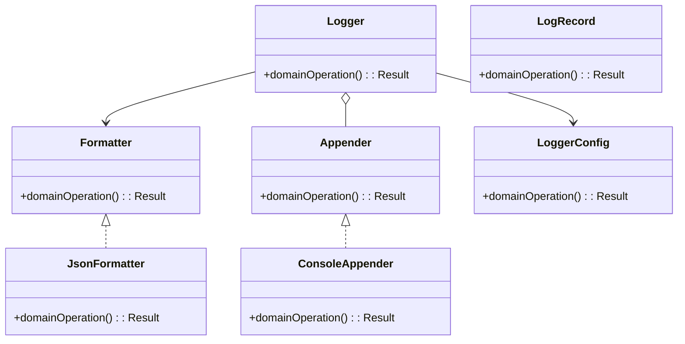
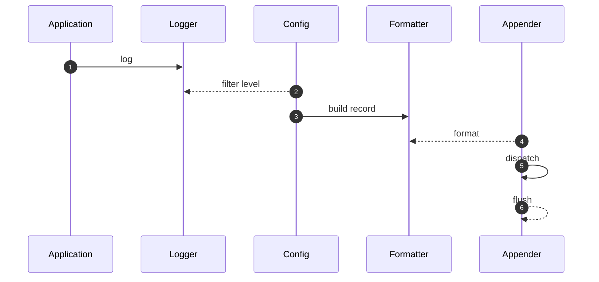

# Logger Framework — LLD Interview Guide

**Problem:** Structured logging with levels, context and pluggable sinks.

## Clarifying questions
- Levels/filter?
- JSON/text?
- Sync/async appenders?
- Sink failure/queue full?
- Context propagation?
- Redaction/rotation?
- Flush guarantees?
Ask what changes invariants, APIs or trade-offs; state assumptions for the rest.

## Entity discovery and responsibilities
Candidate concepts: Logger, LogRecord, Formatter, Appender, LoggerConfig, JsonFormatter, ConsoleAppender. Classify as entity, value object, policy, application service or infrastructure port. Avoid making every noun a class.

| Class | Responsibility |
|---|---|
| `Logger` | Own cohesive state/behaviour; keep orchestration and IO separate. |
| `LogRecord` | Own cohesive state/behaviour; keep orchestration and IO separate. |
| `Formatter` | Own cohesive state/behaviour; keep orchestration and IO separate. |
| `Appender` | Own cohesive state/behaviour; keep orchestration and IO separate. |
| `LoggerConfig` | Own cohesive state/behaviour; keep orchestration and IO separate. |
| `JsonFormatter` | Own cohesive state/behaviour; keep orchestration and IO separate. |
| `ConsoleAppender` | Own cohesive state/behaviour; keep orchestration and IO separate. |

Keep invariants with their state owner, expose intent-focused methods, avoid public mutable fields, and inject dependencies for deterministic tests.

## Class diagram

## Sequence diagram

This is the happy path. Explain validation, persistence, atomicity, retries and failure boundaries.

## SOLID
- **S:** separate domain policy, orchestration, persistence and IO.
- **O:** extend through abstractions only for real variation.
- **L:** implementations honour behavioural/error contracts.
- **I:** ports expose only client-needed operations.
- **D:** use-case logic depends on abstractions; adapters implement infrastructure.

## Patterns that may fit
- Strategy for formatting
- Chain of appenders
- Decorator for redaction
Explain the design pressure and complexity introduced before applying a pattern.

## Edge cases and tests
1. **Invalid level** — define expected outcome and add a focused test.
2. **Appender throws** — define expected outcome and add a focused test.
3. **Queue overflow** — define expected outcome and add a focused test.
4. **Sensitive data** — define expected outcome and add a focused test.
5. **Concurrent rotation** — define expected outcome and add a focused test.
6. **Shutdown flush** — define expected outcome and add a focused test.
7. **Recursive failure** — define expected outcome and add a focused test.

## Senior-level trade-off
Logging must not destabilise the application; define loss/backpressure policy. Discuss multi-instance behaviour, observability, security and recovery; distinguish code guarantees from infrastructure guarantees.

## Interview wrap-up
Summarise assumptions, entities, main flow, pattern rationale, hardest edge case and one limitation/next evolution.
