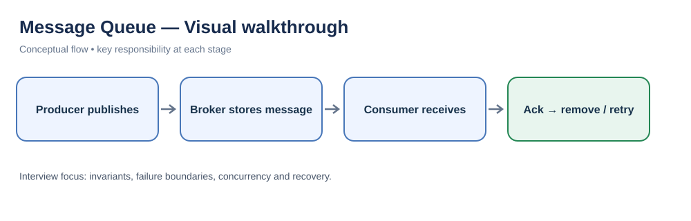
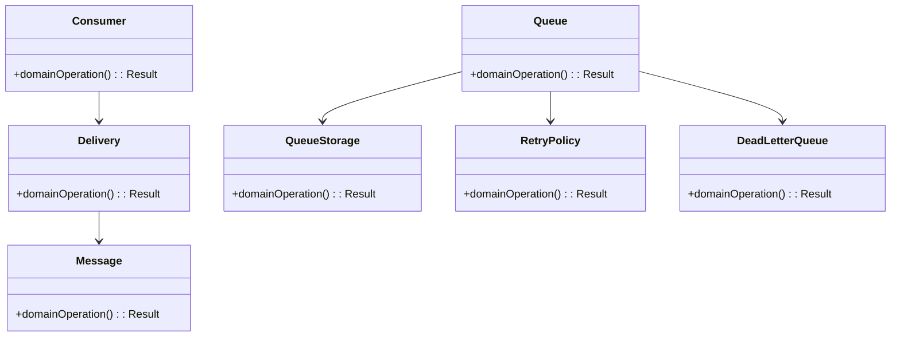
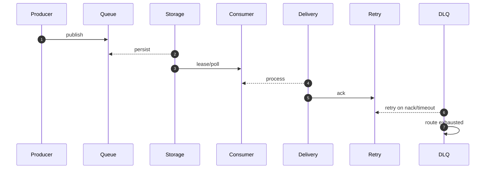

# Message Queue — LLD Interview Guide

**Problem:** Deliver messages with defined ordering, ack and retry semantics.

## Visual walkthrough

A message remains pending until acknowledged. Failures trigger retry or dead-letter routing; delivery guarantees and idempotency must be explicit.

## Clarifying questions
- Delivery guarantee?
- Ordering scope?
- Ack/visibility timeout?
- Retry/DLQ?
- Consumer scaling?
- Duplicate handling?
- Durability/retention?
Ask what changes invariants, APIs or trade-offs; state assumptions for the rest.

## Entity discovery and responsibilities
Candidate concepts: Queue, Message, Delivery, Consumer, QueueStorage, RetryPolicy, DeadLetterQueue. Classify as entity, value object, policy, application service or infrastructure port. Avoid making every noun a class.

| Class | Responsibility |
|---|---|
| `Queue` | Own cohesive state/behaviour; keep orchestration and IO separate. |
| `Message` | Own cohesive state/behaviour; keep orchestration and IO separate. |
| `Delivery` | Own cohesive state/behaviour; keep orchestration and IO separate. |
| `Consumer` | Own cohesive state/behaviour; keep orchestration and IO separate. |
| `QueueStorage` | Own cohesive state/behaviour; keep orchestration and IO separate. |
| `RetryPolicy` | Own cohesive state/behaviour; keep orchestration and IO separate. |
| `DeadLetterQueue` | Own cohesive state/behaviour; keep orchestration and IO separate. |

Keep invariants with their state owner, expose intent-focused methods, avoid public mutable fields, and inject dependencies for deterministic tests.

## Class diagram

## Sequence diagram

This is the happy path. Explain validation, persistence, atomicity, retries and failure boundaries.

## SOLID
- **S:** separate domain policy, orchestration, persistence and IO.
- **O:** extend through abstractions only for real variation.
- **L:** implementations honour behavioural/error contracts.
- **I:** ports expose only client-needed operations.
- **D:** use-case logic depends on abstractions; adapters implement infrastructure.

## Patterns that may fit
- Pub-Sub for fanout
- Strategy for retry
- Adapter for broker
Explain the design pressure and complexity introduced before applying a pattern.

## Edge cases and tests
1. **Duplicate delivery** — define expected outcome and add a focused test.
2. **Crash before ack** — define expected outcome and add a focused test.
3. **Visibility timeout** — define expected outcome and add a focused test.
4. **Poison message** — define expected outcome and add a focused test.
5. **Partition ordering** — define expected outcome and add a focused test.
6. **Backpressure** — define expected outcome and add a focused test.
7. **Retry storm** — define expected outcome and add a focused test.
8. **DLQ redrive** — define expected outcome and add a focused test.

## Senior-level trade-off
Assume at-least-once by default; consumers should be idempotent. Discuss multi-instance behaviour, observability, security and recovery; distinguish code guarantees from infrastructure guarantees.

## Interview wrap-up
Summarise assumptions, entities, main flow, pattern rationale, hardest edge case and one limitation/next evolution.
