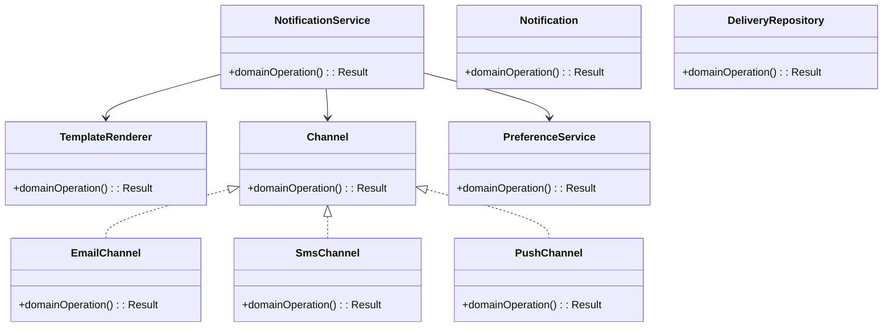
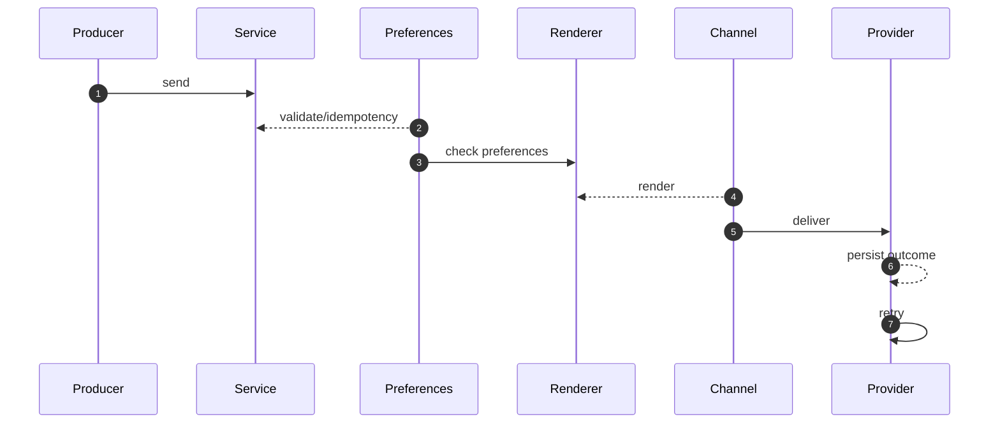

# Notification System — LLD Interview Guide

**Problem:** Deliver notifications through channels with preferences, templates and retries.

## Clarifying questions
- Which channels?
- Transactional or best-effort?
- Preferences/quiet hours?
- Template localization/versioning?
- Provider limits?
- Delivery/read receipts?
- Duplicate prevention?
Ask what changes invariants, APIs or trade-offs; state assumptions for the rest.

## Entity discovery and responsibilities
Candidate concepts: NotificationService, Notification, TemplateRenderer, Channel, EmailChannel, SmsChannel, PushChannel, PreferenceService, DeliveryRepository. Classify as entity, value object, policy, application service or infrastructure port. Avoid making every noun a class.

| Class | Responsibility |
|---|---|
| `NotificationService` | Own cohesive state/behaviour; keep orchestration and IO separate. |
| `Notification` | Own cohesive state/behaviour; keep orchestration and IO separate. |
| `TemplateRenderer` | Own cohesive state/behaviour; keep orchestration and IO separate. |
| `Channel` | Own cohesive state/behaviour; keep orchestration and IO separate. |
| `EmailChannel` | Own cohesive state/behaviour; keep orchestration and IO separate. |
| `SmsChannel` | Own cohesive state/behaviour; keep orchestration and IO separate. |
| `PushChannel` | Own cohesive state/behaviour; keep orchestration and IO separate. |
| `PreferenceService` | Own cohesive state/behaviour; keep orchestration and IO separate. |
| `DeliveryRepository` | Own cohesive state/behaviour; keep orchestration and IO separate. |

Keep invariants with their state owner, expose intent-focused methods, avoid public mutable fields, and inject dependencies for deterministic tests.

## Class diagram

## Sequence diagram

This is the happy path. Explain validation, persistence, atomicity, retries and failure boundaries.

## SOLID
- **S:** separate domain policy, orchestration, persistence and IO.
- **O:** extend through abstractions only for real variation.
- **L:** implementations honour behavioural/error contracts.
- **I:** ports expose only client-needed operations.
- **D:** use-case logic depends on abstractions; adapters implement infrastructure.

## Patterns that may fit
- Strategy channels
- Adapter providers
- Factory channel
- Outbox reliable sends
Explain the design pressure and complexity introduced before applying a pattern.

## Edge cases and tests
1. **Invalid destination** — define expected outcome and add a focused test.
2. **Opt-out/quiet hours** — define expected outcome and add a focused test.
3. **Ambiguous timeout** — define expected outcome and add a focused test.
4. **Provider limit** — define expected outcome and add a focused test.
5. **Duplicate event** — define expected outcome and add a focused test.
6. **Template error** — define expected outcome and add a focused test.
7. **Retry exhaustion** — define expected outcome and add a focused test.
8. **Fallback consent** — define expected outcome and add a focused test.

## Senior-level trade-off
Separate notification intent from delivery; respect consent and ambiguous provider outcomes. Discuss multi-instance behaviour, observability, security and recovery; distinguish code guarantees from infrastructure guarantees.

## Interview wrap-up
Summarise assumptions, entities, main flow, pattern rationale, hardest edge case and one limitation/next evolution.
