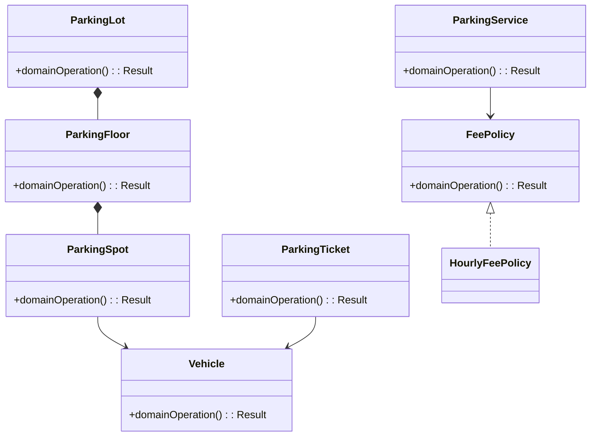
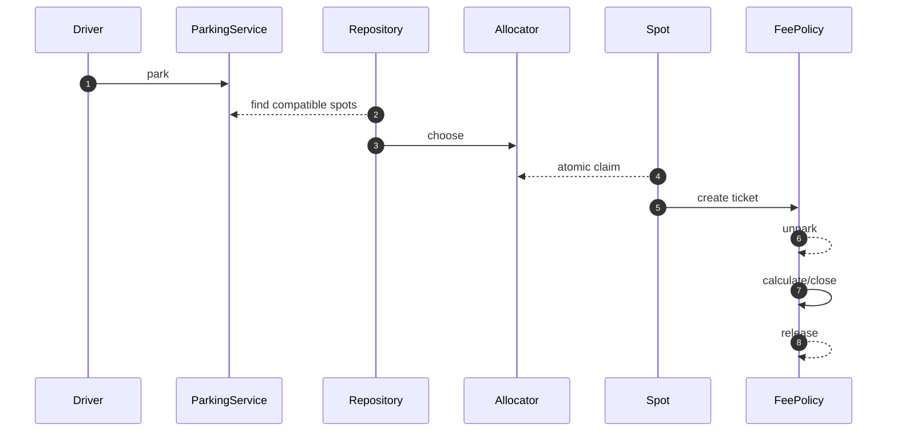

# Parking Lot — LLD Interview Guide

**Problem:** Allocate compatible spots, issue tickets and calculate fees.

## Clarifying questions
- Vehicle/spot types?
- Multi-spot vehicles?
- Allocation preference?
- Fee rounding/caps?
- Reservations/lost ticket?
- Concurrent claims?
- Payment before release?
Ask what changes invariants, APIs or trade-offs; state assumptions for the rest.

## Entity discovery and responsibilities
Candidate concepts: ParkingLot, ParkingFloor, ParkingSpot, Vehicle, ParkingTicket, FeePolicy, ParkingService. Classify as entity, value object, policy, application service or infrastructure port. Avoid making every noun a class.

| Class | Responsibility |
|---|---|
| `ParkingLot` | Own cohesive state/behaviour; keep orchestration and IO separate. |
| `ParkingFloor` | Own cohesive state/behaviour; keep orchestration and IO separate. |
| `ParkingSpot` | Own cohesive state/behaviour; keep orchestration and IO separate. |
| `Vehicle` | Own cohesive state/behaviour; keep orchestration and IO separate. |
| `ParkingTicket` | Own cohesive state/behaviour; keep orchestration and IO separate. |
| `FeePolicy` | Own cohesive state/behaviour; keep orchestration and IO separate. |
| `ParkingService` | Own cohesive state/behaviour; keep orchestration and IO separate. |

Keep invariants with their state owner, expose intent-focused methods, avoid public mutable fields, and inject dependencies for deterministic tests.

## Class diagram

## Sequence diagram

This is the happy path. Explain validation, persistence, atomicity, retries and failure boundaries.

## SOLID
- **S:** separate domain policy, orchestration, persistence and IO.
- **O:** extend through abstractions only for real variation.
- **L:** implementations honour behavioural/error contracts.
- **I:** ports expose only client-needed operations.
- **D:** use-case logic depends on abstractions; adapters implement infrastructure.

## Patterns that may fit
- Strategy allocation/fees
- State ticket lifecycle
- Repository persistence
Explain the design pressure and complexity introduced before applying a pattern.

## Edge cases and tests
1. **No spot** — define expected outcome and add a focused test.
2. **Overwrite occupant** — define expected outcome and add a focused test.
3. **Unknown/closed ticket** — define expected outcome and add a focused test.
4. **Exit before entry** — define expected outcome and add a focused test.
5. **Rounding boundary** — define expected outcome and add a focused test.
6. **Concurrent claim** — define expected outcome and add a focused test.
7. **Partial write** — define expected outcome and add a focused test.
8. **Duplicate unpark** — define expected outcome and add a focused test.

## Senior-level trade-off
Cross-instance invariants need transactional or atomic persistence. Discuss multi-instance behaviour, observability, security and recovery; distinguish code guarantees from infrastructure guarantees.

## Interview wrap-up
Summarise assumptions, entities, main flow, pattern rationale, hardest edge case and one limitation/next evolution.
