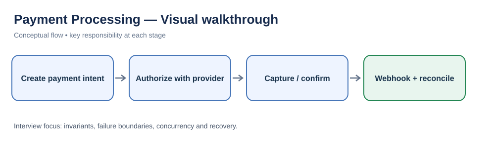
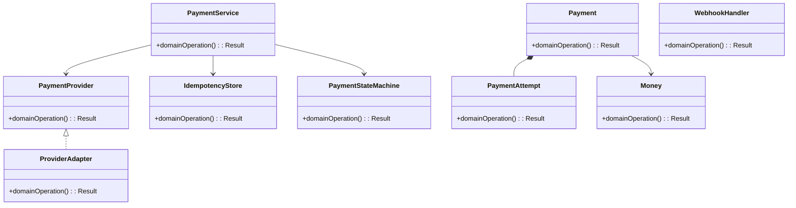
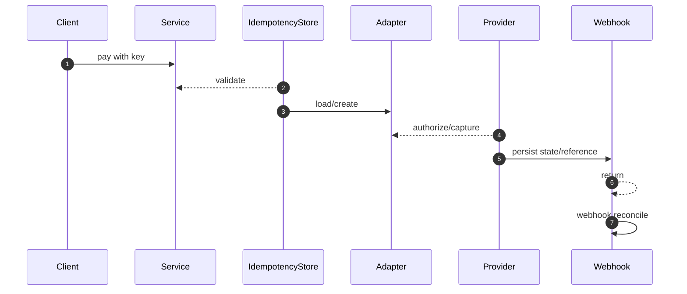

# Payment Processing — LLD Interview Guide

**Problem:** Authorize, capture, refund and reconcile through providers.

## Visual walkthrough

Treat payment as a state machine. Provider calls use idempotency keys; asynchronous webhooks and reconciliation resolve uncertain outcomes.

## Clarifying questions
- Auth/capture separate?
- Methods/providers?
- Payment states?
- Idempotency scope?
- Ambiguous timeout?
- Partial refunds?
- Webhook auth/dedup?
Ask what changes invariants, APIs or trade-offs; state assumptions for the rest.

## Entity discovery and responsibilities
Candidate concepts: PaymentService, Payment, PaymentAttempt, PaymentProvider, ProviderAdapter, IdempotencyStore, PaymentStateMachine, WebhookHandler, Money. Classify as entity, value object, policy, application service or infrastructure port. Avoid making every noun a class.

| Class | Responsibility |
|---|---|
| `PaymentService` | Own cohesive state/behaviour; keep orchestration and IO separate. |
| `Payment` | Own cohesive state/behaviour; keep orchestration and IO separate. |
| `PaymentAttempt` | Own cohesive state/behaviour; keep orchestration and IO separate. |
| `PaymentProvider` | Own cohesive state/behaviour; keep orchestration and IO separate. |
| `ProviderAdapter` | Own cohesive state/behaviour; keep orchestration and IO separate. |
| `IdempotencyStore` | Own cohesive state/behaviour; keep orchestration and IO separate. |
| `PaymentStateMachine` | Own cohesive state/behaviour; keep orchestration and IO separate. |
| `WebhookHandler` | Own cohesive state/behaviour; keep orchestration and IO separate. |
| `Money` | Own cohesive state/behaviour; keep orchestration and IO separate. |

Keep invariants with their state owner, expose intent-focused methods, avoid public mutable fields, and inject dependencies for deterministic tests.

## Class diagram

## Sequence diagram

This is the happy path. Explain validation, persistence, atomicity, retries and failure boundaries.

## SOLID
- **S:** separate domain policy, orchestration, persistence and IO.
- **O:** extend through abstractions only for real variation.
- **L:** implementations honour behavioural/error contracts.
- **I:** ports expose only client-needed operations.
- **D:** use-case logic depends on abstractions; adapters implement infrastructure.

## Patterns that may fit
- Adapter providers
- State lifecycle
- Strategy routing
- Inbox/outbox
Explain the design pressure and complexity introduced before applying a pattern.

## Edge cases and tests
1. **Duplicate retry** — define expected outcome and add a focused test.
2. **Timeout after charge** — define expected outcome and add a focused test.
3. **Webhook before response** — define expected outcome and add a focused test.
4. **Duplicate/out-of-order event** — define expected outcome and add a focused test.
5. **Partial refund** — define expected outcome and add a focused test.
6. **Currency precision** — define expected outcome and add a focused test.
7. **Auth expiry** — define expected outcome and add a focused test.
8. **Reconciliation** — define expected outcome and add a focused test.

## Senior-level trade-off
Never blindly retry ambiguous charges; use idempotency, webhooks and reconciliation. Discuss multi-instance behaviour, observability, security and recovery; distinguish code guarantees from infrastructure guarantees.

## Interview wrap-up
Summarise assumptions, entities, main flow, pattern rationale, hardest edge case and one limitation/next evolution.
