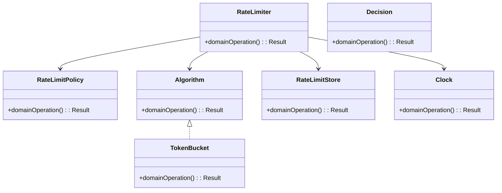
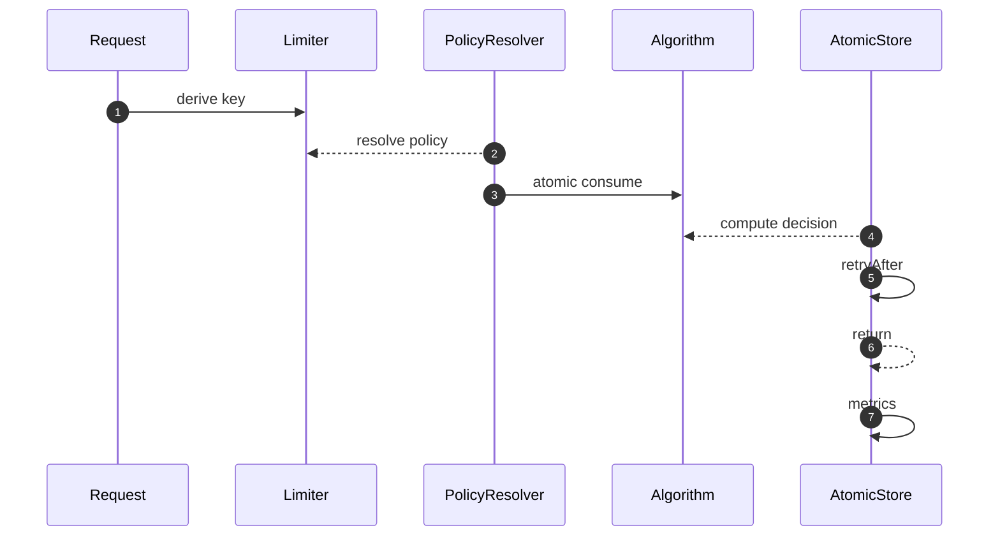

# Rate Limiter — LLD Interview Guide

**Problem:** Control request rate by identity and policy.

## Clarifying questions
- Identity key?
- Algorithm?
- Burst capacity?
- Local/global?
- Store outage policy?
- Policy updates?
- Retry-After?
Ask what changes invariants, APIs or trade-offs; state assumptions for the rest.

## Entity discovery and responsibilities
Candidate concepts: RateLimiter, RateLimitPolicy, Algorithm, TokenBucket, RateLimitStore, Clock, Decision. Classify as entity, value object, policy, application service or infrastructure port. Avoid making every noun a class.

| Class | Responsibility |
|---|---|
| `RateLimiter` | Own cohesive state/behaviour; keep orchestration and IO separate. |
| `RateLimitPolicy` | Own cohesive state/behaviour; keep orchestration and IO separate. |
| `Algorithm` | Own cohesive state/behaviour; keep orchestration and IO separate. |
| `TokenBucket` | Own cohesive state/behaviour; keep orchestration and IO separate. |
| `RateLimitStore` | Own cohesive state/behaviour; keep orchestration and IO separate. |
| `Clock` | Own cohesive state/behaviour; keep orchestration and IO separate. |
| `Decision` | Own cohesive state/behaviour; keep orchestration and IO separate. |

Keep invariants with their state owner, expose intent-focused methods, avoid public mutable fields, and inject dependencies for deterministic tests.

## Class diagram

## Sequence diagram

This is the happy path. Explain validation, persistence, atomicity, retries and failure boundaries.

## SOLID
- **S:** separate domain policy, orchestration, persistence and IO.
- **O:** extend through abstractions only for real variation.
- **L:** implementations honour behavioural/error contracts.
- **I:** ports expose only client-needed operations.
- **D:** use-case logic depends on abstractions; adapters implement infrastructure.

## Patterns that may fit
- Strategy algorithms
- Factory policy
- Adapter Redis
Explain the design pressure and complexity introduced before applying a pattern.

## Edge cases and tests
1. **Window burst** — define expected outcome and add a focused test.
2. **Clock skew** — define expected outcome and add a focused test.
3. **Concurrent increments** — define expected outcome and add a focused test.
4. **Missing key** — define expected outcome and add a focused test.
5. **Cost > capacity** — define expected outcome and add a focused test.
6. **Store outage** — define expected outcome and add a focused test.
7. **Policy update** — define expected outcome and add a focused test.
8. **Hot key** — define expected outcome and add a focused test.

## Senior-level trade-off
Distributed quotas require atomic shared state and an explicit outage policy. Discuss multi-instance behaviour, observability, security and recovery; distinguish code guarantees from infrastructure guarantees.

## Interview wrap-up
Summarise assumptions, entities, main flow, pattern rationale, hardest edge case and one limitation/next evolution.
