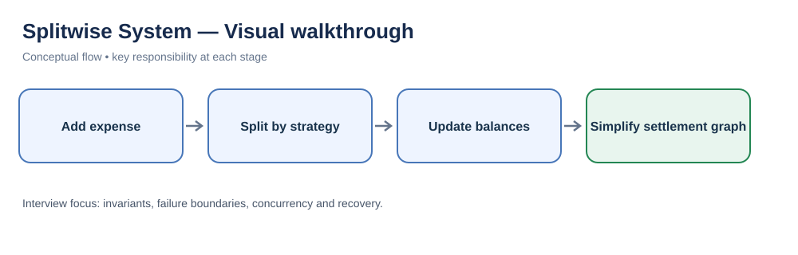
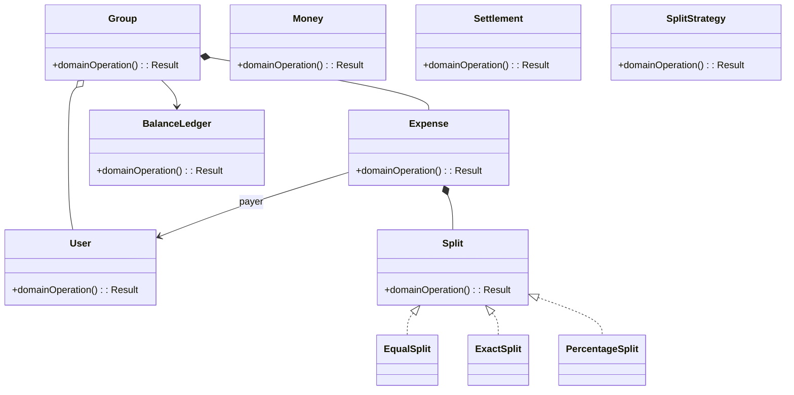
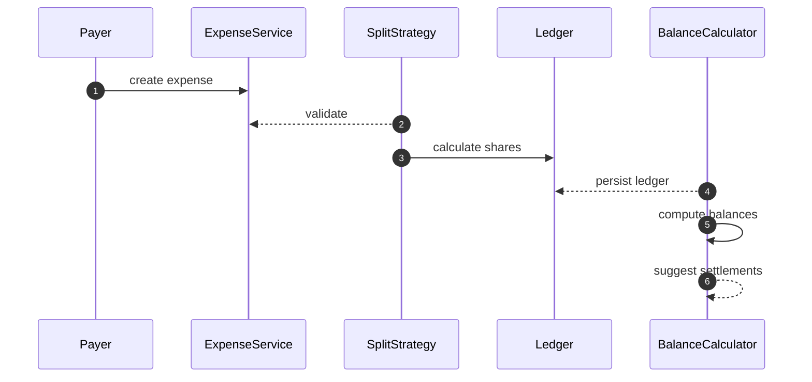

# Splitwise System — LLD Interview Guide

**Problem:** Track group expenses and calculate balances/settlements.

## Visual walkthrough

Expense splits produce pairwise net balances. Settlement simplification reduces transfers while preserving each participant’s net position.

## Clarifying questions
- Split types?
- Currency/rounding?
- Edit after settlement?
- Balance scope?
- Debt simplification?
- Member validation?
- Settlement authority?
Ask what changes invariants, APIs or trade-offs; state assumptions for the rest.

## Entity discovery and responsibilities
Candidate concepts: Group, User, Expense, Split, Money, BalanceLedger, Settlement, SplitStrategy. Classify as entity, value object, policy, application service or infrastructure port. Avoid making every noun a class.

| Class | Responsibility |
|---|---|
| `Group` | Own cohesive state/behaviour; keep orchestration and IO separate. |
| `User` | Own cohesive state/behaviour; keep orchestration and IO separate. |
| `Expense` | Own cohesive state/behaviour; keep orchestration and IO separate. |
| `Split` | Own cohesive state/behaviour; keep orchestration and IO separate. |
| `Money` | Own cohesive state/behaviour; keep orchestration and IO separate. |
| `BalanceLedger` | Own cohesive state/behaviour; keep orchestration and IO separate. |
| `Settlement` | Own cohesive state/behaviour; keep orchestration and IO separate. |
| `SplitStrategy` | Own cohesive state/behaviour; keep orchestration and IO separate. |

Keep invariants with their state owner, expose intent-focused methods, avoid public mutable fields, and inject dependencies for deterministic tests.

## Class diagram

## Sequence diagram

This is the happy path. Explain validation, persistence, atomicity, retries and failure boundaries.

## SOLID
- **S:** separate domain policy, orchestration, persistence and IO.
- **O:** extend through abstractions only for real variation.
- **L:** implementations honour behavioural/error contracts.
- **I:** ports expose only client-needed operations.
- **D:** use-case logic depends on abstractions; adapters implement infrastructure.

## Patterns that may fit
- Strategy split calculation
- Factory split type
- Debt simplification service
Explain the design pressure and complexity introduced before applying a pattern.

## Edge cases and tests
1. **Rounding remainder** — define expected outcome and add a focused test.
2. **Payer inclusion** — define expected outcome and add a focused test.
3. **Negative amount** — define expected outcome and add a focused test.
4. **Member leaves** — define expected outcome and add a focused test.
5. **Multi-currency** — define expected outcome and add a focused test.
6. **Duplicate expense** — define expected outcome and add a focused test.
7. **Edit after settlement** — define expected outcome and add a focused test.
8. **Over-settlement** — define expected outcome and add a focused test.

## Senior-level trade-off
Ledger is source of truth; simplified debts must conserve balances. Discuss multi-instance behaviour, observability, security and recovery; distinguish code guarantees from infrastructure guarantees.

## Interview wrap-up
Summarise assumptions, entities, main flow, pattern rationale, hardest edge case and one limitation/next evolution.
