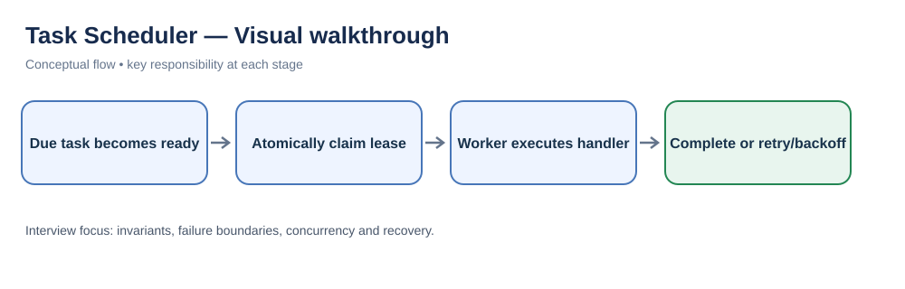
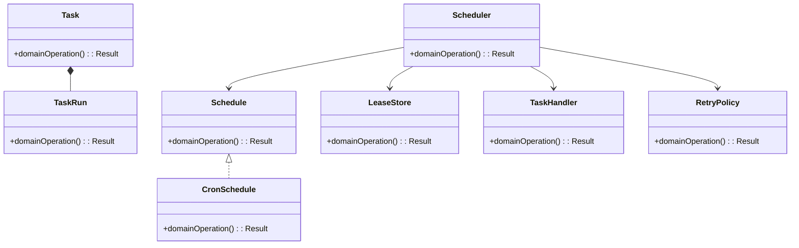
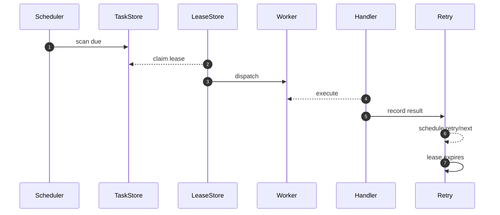

# Task Scheduler — LLD Interview Guide

**Problem:** Schedule and execute one-time/recurring tasks reliably.

## Visual walkthrough

Claims need leases to recover from crashed workers. Execution is typically at-least-once, so handlers should be idempotent.

## Clarifying questions
- Schedule types?
- Timezone/DST?
- Overlap?
- Retry/timeout?
- Worker claim?
- Pause/cancel?
- Guarantee/idempotency?
Ask what changes invariants, APIs or trade-offs; state assumptions for the rest.

## Entity discovery and responsibilities
Candidate concepts: Scheduler, Task, Schedule, CronSchedule, TaskRun, TaskHandler, LeaseStore, RetryPolicy. Classify as entity, value object, policy, application service or infrastructure port. Avoid making every noun a class.

| Class | Responsibility |
|---|---|
| `Scheduler` | Own cohesive state/behaviour; keep orchestration and IO separate. |
| `Task` | Own cohesive state/behaviour; keep orchestration and IO separate. |
| `Schedule` | Own cohesive state/behaviour; keep orchestration and IO separate. |
| `CronSchedule` | Own cohesive state/behaviour; keep orchestration and IO separate. |
| `TaskRun` | Own cohesive state/behaviour; keep orchestration and IO separate. |
| `TaskHandler` | Own cohesive state/behaviour; keep orchestration and IO separate. |
| `LeaseStore` | Own cohesive state/behaviour; keep orchestration and IO separate. |
| `RetryPolicy` | Own cohesive state/behaviour; keep orchestration and IO separate. |

Keep invariants with their state owner, expose intent-focused methods, avoid public mutable fields, and inject dependencies for deterministic tests.

## Class diagram

## Sequence diagram

This is the happy path. Explain validation, persistence, atomicity, retries and failure boundaries.

## SOLID
- **S:** separate domain policy, orchestration, persistence and IO.
- **O:** extend through abstractions only for real variation.
- **L:** implementations honour behavioural/error contracts.
- **I:** ports expose only client-needed operations.
- **D:** use-case logic depends on abstractions; adapters implement infrastructure.

## Patterns that may fit
- Strategy schedule/retry
- Command payload
- State lifecycle
- Outbox dispatch
Explain the design pressure and complexity introduced before applying a pattern.

## Edge cases and tests
1. **Duplicate claim** — define expected outcome and add a focused test.
2. **Worker crash** — define expected outcome and add a focused test.
3. **Lease expiry** — define expected outcome and add a focused test.
4. **DST skip/repeat** — define expected outcome and add a focused test.
5. **Retry storm** — define expected outcome and add a focused test.
6. **Cancel in-flight** — define expected outcome and add a focused test.
7. **Misfire/backfill** — define expected outcome and add a focused test.
8. **Duplicate execution** — define expected outcome and add a focused test.

## Senior-level trade-off
At-least-once is common; use leases and idempotent handlers. Discuss multi-instance behaviour, observability, security and recovery; distinguish code guarantees from infrastructure guarantees.

## Interview wrap-up
Summarise assumptions, entities, main flow, pattern rationale, hardest edge case and one limitation/next evolution.
