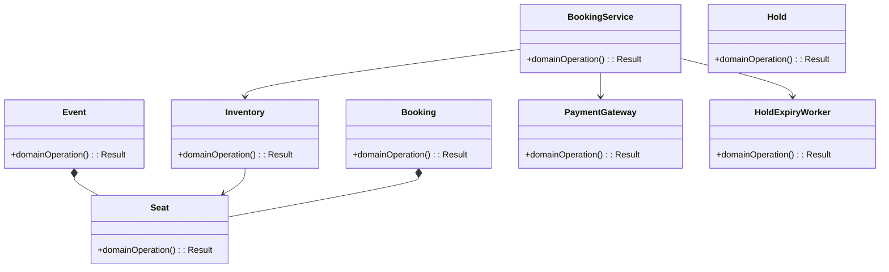
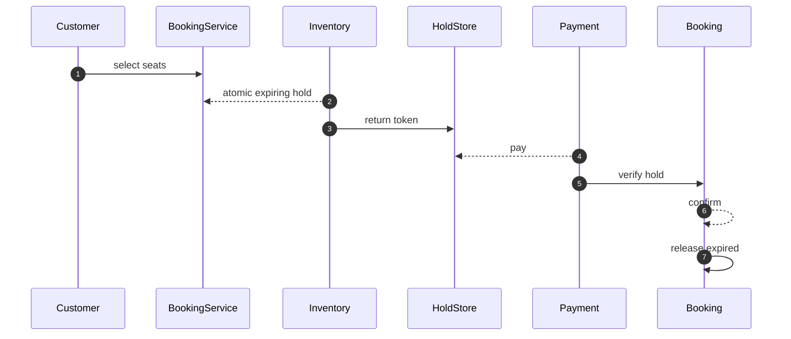

# Ticket Booking — LLD Interview Guide

**Problem:** Hold inventory, accept payment and confirm bookings.

## Clarifying questions
- Assigned or GA?
- Hold duration?
- Atomic multi-seat?
- Payment after expiry?
- Cancellation/refund?
- Duplicate request?
- Inventory consistency?
Ask what changes invariants, APIs or trade-offs; state assumptions for the rest.

## Entity discovery and responsibilities
Candidate concepts: BookingService, Event, Seat, Inventory, Hold, Booking, PaymentGateway, HoldExpiryWorker. Classify as entity, value object, policy, application service or infrastructure port. Avoid making every noun a class.

| Class | Responsibility |
|---|---|
| `BookingService` | Own cohesive state/behaviour; keep orchestration and IO separate. |
| `Event` | Own cohesive state/behaviour; keep orchestration and IO separate. |
| `Seat` | Own cohesive state/behaviour; keep orchestration and IO separate. |
| `Inventory` | Own cohesive state/behaviour; keep orchestration and IO separate. |
| `Hold` | Own cohesive state/behaviour; keep orchestration and IO separate. |
| `Booking` | Own cohesive state/behaviour; keep orchestration and IO separate. |
| `PaymentGateway` | Own cohesive state/behaviour; keep orchestration and IO separate. |
| `HoldExpiryWorker` | Own cohesive state/behaviour; keep orchestration and IO separate. |

Keep invariants with their state owner, expose intent-focused methods, avoid public mutable fields, and inject dependencies for deterministic tests.

## Class diagram

## Sequence diagram

This is the happy path. Explain validation, persistence, atomicity, retries and failure boundaries.

## SOLID
- **S:** separate domain policy, orchestration, persistence and IO.
- **O:** extend through abstractions only for real variation.
- **L:** implementations honour behavioural/error contracts.
- **I:** ports expose only client-needed operations.
- **D:** use-case logic depends on abstractions; adapters implement infrastructure.

## Patterns that may fit
- State booking lifecycle
- Strategy allocation
- Adapter payment
- Saga compensation
Explain the design pressure and complexity introduced before applying a pattern.

## Edge cases and tests
1. **Seat race** — define expected outcome and add a focused test.
2. **Hold expires** — define expected outcome and add a focused test.
3. **Payment after expiry** — define expected outcome and add a focused test.
4. **Partial claim** — define expected outcome and add a focused test.
5. **Duplicate confirm** — define expected outcome and add a focused test.
6. **Expiry delayed** — define expected outcome and add a focused test.
7. **Cancel/refund race** — define expected outcome and add a focused test.
8. **Layout change** — define expected outcome and add a focused test.

## Senior-level trade-off
Atomic holds and compensation are core correctness requirements. Discuss multi-instance behaviour, observability, security and recovery; distinguish code guarantees from infrastructure guarantees.

## Interview wrap-up
Summarise assumptions, entities, main flow, pattern rationale, hardest edge case and one limitation/next evolution.
