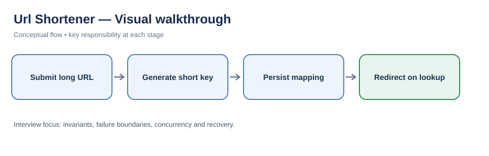
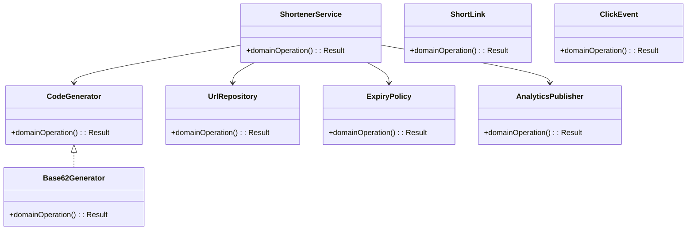
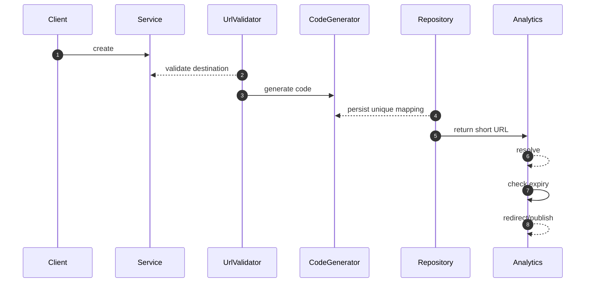

# URL Shortener — LLD Interview Guide

**Problem:** Create compact links and resolve redirects with expiry/alias/abuse controls.

## Visual walkthrough

Creation stores a unique key-to-URL mapping; reads resolve the key and redirect. Collision handling, expiry and abuse controls are important.

## Clarifying questions
- Custom alias?
- Expiry/disable?
- Deduplicate URLs?
- Redirect status?
- Collision?
- Async analytics?
- Abuse checks?
Ask what changes invariants, APIs or trade-offs; state assumptions for the rest.

## Entity discovery and responsibilities
Candidate concepts: ShortenerService, ShortLink, CodeGenerator, Base62Generator, UrlRepository, ExpiryPolicy, ClickEvent, AnalyticsPublisher. Classify as entity, value object, policy, application service or infrastructure port. Avoid making every noun a class.

| Class | Responsibility |
|---|---|
| `ShortenerService` | Own cohesive state/behaviour; keep orchestration and IO separate. |
| `ShortLink` | Own cohesive state/behaviour; keep orchestration and IO separate. |
| `CodeGenerator` | Own cohesive state/behaviour; keep orchestration and IO separate. |
| `Base62Generator` | Own cohesive state/behaviour; keep orchestration and IO separate. |
| `UrlRepository` | Own cohesive state/behaviour; keep orchestration and IO separate. |
| `ExpiryPolicy` | Own cohesive state/behaviour; keep orchestration and IO separate. |
| `ClickEvent` | Own cohesive state/behaviour; keep orchestration and IO separate. |
| `AnalyticsPublisher` | Own cohesive state/behaviour; keep orchestration and IO separate. |

Keep invariants with their state owner, expose intent-focused methods, avoid public mutable fields, and inject dependencies for deterministic tests.

## Class diagram

## Sequence diagram

This is the happy path. Explain validation, persistence, atomicity, retries and failure boundaries.

## SOLID
- **S:** separate domain policy, orchestration, persistence and IO.
- **O:** extend through abstractions only for real variation.
- **L:** implementations honour behavioural/error contracts.
- **I:** ports expose only client-needed operations.
- **D:** use-case logic depends on abstractions; adapters implement infrastructure.

## Patterns that may fit
- Strategy code generation
- Adapter analytics
- Policy factory
Explain the design pressure and complexity introduced before applying a pattern.

## Edge cases and tests
1. **Collision** — define expected outcome and add a focused test.
2. **Alias conflict** — define expected outcome and add a focused test.
3. **Expired link** — define expected outcome and add a focused test.
4. **Unsafe URL** — define expected outcome and add a focused test.
5. **Cache stampede** — define expected outcome and add a focused test.
6. **Analytics outage** — define expected outcome and add a focused test.
7. **Redirect loop** — define expected outcome and add a focused test.
8. **Phishing report** — define expected outcome and add a focused test.

## Senior-level trade-off
Keep redirects fast; analytics async; protect link creation. Discuss multi-instance behaviour, observability, security and recovery; distinguish code guarantees from infrastructure guarantees.

## Interview wrap-up
Summarise assumptions, entities, main flow, pattern rationale, hardest edge case and one limitation/next evolution.
